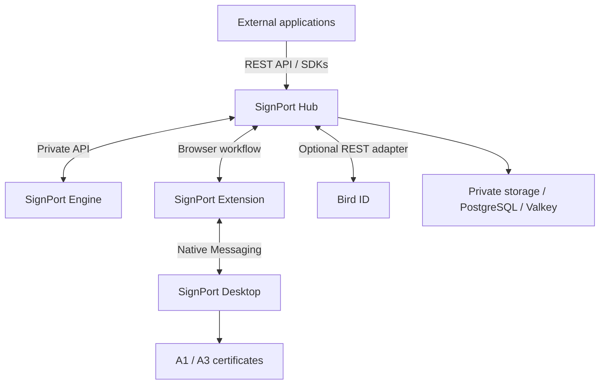

# SignPort

**One port. Any certificate.**

Open-source, self-hosted digital signature infrastructure for developers.

[Português (Brasil)](README.pt-BR.md) · [Specification](SPEC.md) · [Roadmap](ROADMAP.md) · [Contributing](CONTRIBUTING.md) · [Security](SECURITY.md)

> **Pre-alpha — specification and repository scaffold.** No functional signing service, published SDK, browser extension or ICP-Brasil compliance claim yet. The slogan expresses the project's goal, not universal certificate compatibility.

## Why SignPort?

Integrating digital signatures into web applications often requires proprietary signing engines, native certificate middleware, separate cloud integrations and complex PDF/CMS handling. SignPort aims to provide a common API and extensible certificate adapters, keeping documents under the operator's control and avoiding software-imposed per-signature fees.

The name combines **Sign** and **Port**, reflecting a gateway to digital signatures and the Ports & Adapters architectural pattern.

## Planned capabilities

- Local A1 certificates, A3 USB tokens and smart cards (Windows first).
- Optional cloud certificate providers, starting with Bird ID, subject to provider terms.
- PAdES PDF signing, external cryptographic signing, validation and ICP-Brasil policy support.
- Individual and batch signing, multiple signatures, audit trails and tenant isolation.
- REST API, independent PHP and JavaScript SDKs and self-hosted deployment.

## Architecture

| Component | Technology | License strategy |
|---|---|---|
| [Hub](apps/hub/) | Laravel, React, Inertia | AGPL-3.0-or-later |
| [Engine](apps/engine/) | Python, FastAPI, pyHanko | AGPL-3.0-or-later |
| [Desktop](apps/desktop/) | C#, .NET, CNG, PKCS#11 | GPL-3.0-or-later |
| [Extension](apps/extension/) | TypeScript, WXT, Manifest V3 | GPL-3.0-or-later |
| [JS SDK](packages/sdk-js/) / [PHP SDK](packages/sdk-php/) | TypeScript / PHP | Apache-2.0 |
| [Protocol](packages/protocol/) | OpenAPI, JSON Schema | Apache-2.0 |
| [Bird ID adapter](providers/birdid/) | PHP, OAuth2, REST | AGPL-3.0-or-later |
| [Documentation](docs/) | Markdown, VitePress (planned) | CC-BY-4.0 |

## Getting started

This repository currently contains design documents, agent instructions, component scaffolds and the in-progress P0 protocol contracts (schemas and contract tests only, not a running service). There is no executable installation or Docker Compose deployment yet.

1. Read [SPEC.md](SPEC.md) (v2.3.1) and [AGENTS.md](AGENTS.md).
2. Follow [ROADMAP.md](ROADMAP.md), the canonical implementation order, beginning with P0: protocol contracts ([packages/protocol](packages/protocol/)).
3. See [the first development task](docs/first-agent-task.md) and [release gates](docs/release-gates.md).

## Security and independence

Private keys remain with the local certificate provider or cloud HSM. PINs are not sent to the backend. Signing must require explicit authorization bound to the document and certificate. These are design requirements, not independently verified guarantees. No mandatory central service or telemetry is planned. External certificates, cloud APIs and infrastructure may incur costs.

## Governance and licensing

Founded and initially maintained by Lucas Azevedo. SignPort starts as a founder-led project hosted in the founder's personal GitHub account, with an independent organization possible later. See [GOVERNANCE.md](GOVERNANCE.md).

The hybrid license strategy protects improvements to the core while enabling independent commercial integrations. See [LICENSE](LICENSE) for component scopes and pending formal grant, and [LICENSES](LICENSES/). Publication is subject to rights-holder and notice confirmation; the license strategy alone is not a grant for third-party material.

Contributions are welcome once the repository is public. Please follow [CONTRIBUTING.md](CONTRIBUTING.md) and report vulnerabilities privately as described in [SECURITY.md](SECURITY.md).
