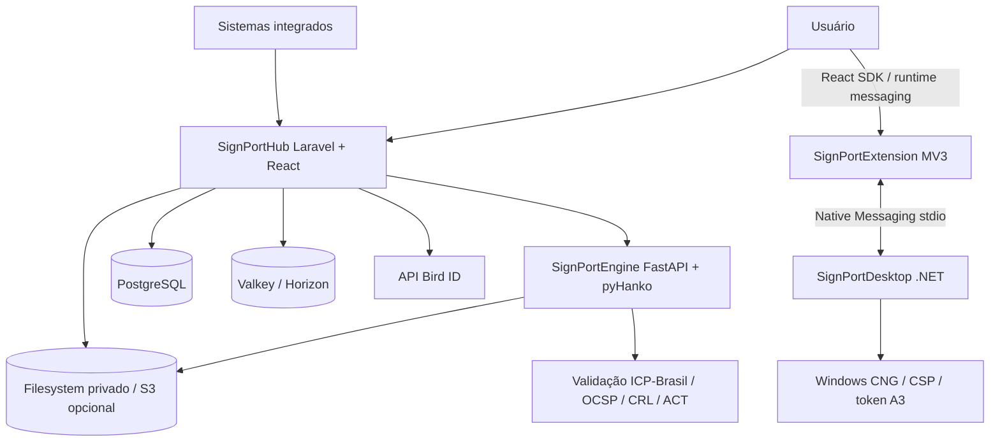
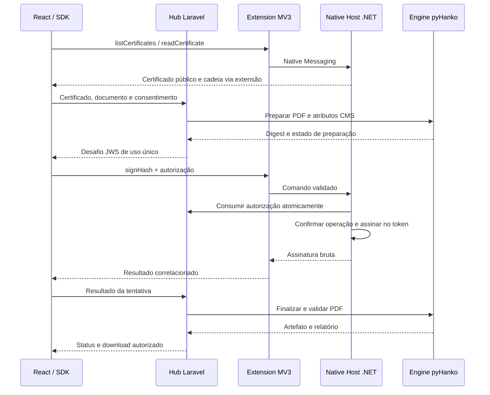

# SignPort — Especificação técnica e requisitos de implementação

**Open Source Edition**

**Versão:** 2.3 | **Data:** 26/11/2026 | **Estado:** arquitetura e estratégia de licença aprovadas pelo solicitante; publicação, integração cloud e homologação pendentes

**Histórico v2.3:** renomeia o projeto para SignPort e define governança founder-led, repositório pessoal inicial e identidade técnica independente. ADR-0012 (seção 29) complementa os anteriores.

**Histórico v2.2:** consolida a stack tecnológica por componente, Valkey e filesystem privado como defaults, contratos compartilhados, estratégia de extensão multi-instância e ADRs 0002–0011. Versões exatas e compatibilidade ficam sujeitas aos gates da seção 28. As decisões de licença v2.1 permanecem vigentes.

**Histórico v2.1:** adota AGPL-3.0-or-later no núcleo, GPL-3.0-or-later nos clientes nativos e Apache-2.0 nos SDKs e protocolos; define integração Bird ID opcional com credenciais por operador, análise documental e gates contratuais. A decisão de estratégia não equivale à concessão formal de direitos sobre código ainda não publicado.

**Histórico v2.0:** preserva a arquitetura Native Messaging da v1.1 e acrescenta estratégia open source, monorepo, distribuição, governança, modelo Community/Cloud, segurança de releases e gate de licenciamento Apache-2.0. A proposta Apache uniforme foi substituída pela decisão v2.1. As seções 22–24 prevalecem em matéria de licenciamento e Bird ID.

**Histórico v1.1:** substitui agente conectado por pareamento/polling por extensão Manifest V3 + Native Messaging; introduz SDK web próprio e autorização criptográfica por tentativa.

## 1. Objetivo e escopo
Construir uma plataforma centralizada de assinatura digital qualificada ICP-Brasil, independente de Lacuna Web PKI e BirdID Pro/CESS, reutilizável por sistemas clínicos, teleradiologia e outros SaaS. O MVP contempla PDF/PAdES, certificados A1 instalados e A3 físicos no Windows, Bird ID em nuvem, assinatura individual e em lote, auditoria, validação e API multi-tenant. A plataforma não emite certificados, não custodia chaves privadas e não substitui uma autoridade certificadora.

Premissas: priorizar componentes livres, manter documentos em infraestrutura controlada, usar SHA-256 e RSA inicialmente, oferecer interface web em português. Custos de certificados, Bird ID, carimbo de tempo, assinatura de código do instalador, infraestrutura e manutenção não são eliminados. A gratuidade comercial da API Bird ID não foi confirmada; o uso do certificado consome créditos do titular conforme o plano (ver seção 24).

Fora do MVP: CAdES/XAdES, Linux/macOS desktop, Firefox, Safari, upload de PFX ao servidor, assinatura GOV.BR, outros provedores de nuvem, assinatura automática sem consentimento, faturamento, aplicativo móvel próprio e perfis de arquivamento de longo prazo não homologados.

## 2. Arquitetura



| Serviço | Responsabilidade | Não deve fazer |
|---|---|---|
| SignPortHub | Orquestração, autenticação, tenants, API, consentimento, sessões, adaptadores de provedores, auditoria | Implementar manualmente CMS/PDF ou receber PIN |
| SignPortEngine | Preparar PDF, atributos CMS, digest, finalizar, validar, política ICP-Brasil | Autenticar usuários finais ou custodiar chaves de assinatura |
| SignPortExtension | Ponte restrita entre página autorizada e host nativo | Custodiar chaves, PIN ou autorizações persistentes |
| SignPortSDK | SDK TypeScript para detecção e comunicação com extensão | Acessar diretamente o Engine |
| SignPortDesktop | Selecionar certificado, consentimento local, assinar desafio autorizado usando chave local | Expor API genérica de assinatura arbitrária ou armazenar PIN |

Decisão: Hub é fonte de verdade do workflow. Engine é privado e mantém artefatos temporários recuperáveis. React usa SignPortSDK e SignPortExtension para iniciar o host nativo sob demanda via Native Messaging. Não há pareamento obrigatório, heartbeat, polling do Desktop, listener localhost nem serviço Windows permanente. O Hub emite desafios assinados e recebe resultados pela sessão web autenticada. O host pode consultar o Hub por HTTPS somente para consumo atômico de autorização e obtenção de prévia autorizada; não mantém conexão permanente. O browser nunca se comunica diretamente com o Engine. Bird ID recebe apenas os dados criptográficos necessários, não o PDF.

## 3. Ferramentas propostas

| Camada | Ferramenta | Uso |
|---|---|---|
| Hub | PHP 8.4+, Laravel 13 (compatibilidade a validar), React, TypeScript, Inertia, Shadcn, Tailwind | API e interface |
| Hub | Laravel Sanctum ou sessão web; tokens de integração com escopos; Policies | Autenticação e autorização |
| Hub | PostgreSQL, Valkey, Horizon, Scheduler; Reverb opcional | Dados, filas, expiração, notificações |
| Engine | Python 3.13, FastAPI, Uvicorn, Pydantic, pyHanko, pyhanko-certvalidator, cryptography, asn1crypto | PAdES e validação |
| Extension | TypeScript, WXT, Manifest V3, React opcional | Chrome e Edge; service worker e popup de diagnóstico |
| SDK | TypeScript, Vitest | Biblioteca de integração web, inicialmente interna ao Hub |
| Desktop | .NET 10 LTS, Windows Certificate Store, System.Security.Cryptography, WPF mínimo para consentimento | Host nativo sob demanda |
| Distribuição | WiX Toolset / MSI (a validar), Chrome Web Store, Edge Add-ons | Instalação e atualização autenticadas |
| Desktop | PKCS11Interop e middleware do fabricante (fallback) | Tokens sem integração adequada ao Windows |
| Storage | Filesystem privado (default), S3 opcional, versionamento e criptografia | PDFs e estado temporário |
| Infra | Docker Compose, Caddy (Nginx alternativo), TLS, secret store, backups | Implantação inicial |
| Observabilidade | OpenTelemetry, Prometheus, Grafana, logs estruturados | Métricas e rastreabilidade |
| Testes | Pest/PHPUnit, Vitest, Playwright, pytest, xUnit, SoftHSM2 (laboratório), tokens reais | Automação e homologação |
| Contratos | OpenAPI 3.1, JSON Schema, versionamento /v1 | Integração entre serviços |

Fixar versões exatas em lockfiles depois de uma prova de conceito. Verificar licenças de todas as dependências e distribuições (inclusive MinIO, drivers e instaladores); gerar SBOM. Bibliotecas livres não garantem conformidade normativa.

## 4. Requisitos funcionais

| ID | Requisito | Prioridade / aceite |
|---|---|---|
| HUB-01 | Organizações, usuários, papéis admin/operador/assinante/auditor | P0; isolamento por tenant em todas as operações |
| HUB-02 | Aplicações externas com credencial revogável e escopos | P0; credenciais de um cliente não acessam outro |
| HUB-03 | Receber PDF, validar tipo/tamanho, versionar e calcular SHA-256 | P0; documento original imutável |
| HUB-04 | Criar solicitação vinculada a documento, versão, titular esperado e finalidade | P0; autorização de negócio antes da preparação |
| HUB-05 | Exibir PDF e resumo antes do consentimento | P0; consentimento vinculado a hash e versão |
| HUB-06 | Escolher certificado local ou Bird ID | P0; interface única, provedores independentes |
| HUB-07 | Assinar individualmente e consultar resultado | P0; só liberar PDF após validação |
| HUB-08 | Cancelar, expirar, reprocessar com nova tentativa | P0; nenhuma assinatura tardia publicada sem autorização |
| HUB-09 | Assinar lote com resultado por documento | P1; permitir sucesso parcial e retomada segura |
| HUB-10 | Download privado, histórico e webhooks | P0; URLs expiram, eventos deduplicáveis |
| HUB-11 | Verificar PDF recebido e gerar relatório | P1; distinguir válido, inválido e indeterminado |
| HUB-12 | Auditoria de ações e consentimentos | P0; sem PIN, tokens OAuth ou conteúdo clínico nos logs |
| ENG-01 | Preparar PDF em atualização incremental com ByteRange e espaço CMS | P0; preservar assinaturas prévias quando permitido |
| ENG-02 | Gerar atributos assinados, digest e política escolhida | P0; digest correto para assinatura remota |
| ENG-03 | Persistir estado de preparação e retomar após reinício | P0; sem pickle ou desserialização insegura |
| ENG-04 | Verificar assinatura bruta e montar CMS/PAdES | P0; rejeitar chave ou algoritmo divergente |
| ENG-05 | Validar cadeia, integridade, revogação, política e alterações PDF | P0; resultado indeterminado bloqueia liberação automática |
| ENG-06 | Representação visual opcional antes do cálculo do digest | P1; não confundir aparência com assinatura |
| ENG-07 | Carimbo de tempo RFC 3161 por ACT compatível | P1; obrigatório se perfil selecionado exigir |
| EXT-01 | Detectar extensão e host, informar instalação e incompatibilidade | P0; estados distintos para cada falha |
| EXT-02 | Restringir origem e validar schema de mensagens | P0; negar sites e comandos não autorizados |
| EXT-03 | Encaminhar comandos via Native Messaging | P0; correlacionar respostas, timeout e desconexão |
| EXT-04 | Publicar extensão Chrome/Edge e SDK tipado | P0; IDs fixos e permissões mínimas |
| DESK-01 | Instalar host e registrar manifesto Chrome/Edge | P0; iniciar sob demanda, desinstalar sem resíduos |
| DESK-02 | Listar certificados CurrentUser/My com chave privada acessível | P0; distinguir validade e compatibilidade |
| DESK-03 | Retornar certificado público e cadeia em DER/Base64 | P0; nunca exportar chave privada |
| DESK-04 | Exibir confirmação local e assinar digest autorizado | P0; PIN solicitado pelo middleware |
| DESK-05 | Suportar RSA SHA-256 PKCS#1 v1.5 inicialmente | P0; assinatura interoperável |
| DESK-06 | Tratar remoção de token, cancelamento, bloqueio, driver ausente | P0; sem retries automáticos de PIN |
| DESK-07 | Atualização segura e logs sanitizados | P0; instalador e updates autenticados |
| CLOUD-01 | Cadastro e autorização OAuth Bird ID | P0; state, callback, PKCE quando suportado |
| CLOUD-02 | Recuperar certificado e cadeia da sessão | P0; validar titular antes de assinar |
| CLOUD-03 | Assinar digest pela API direta e revogar/expirar autorização | P0; sem CESS |
| CLOUD-04 | Sessões e assinatura múltipla conforme escopos | P1; consentimento limitado a lote definido |

P0 = necessário para MVP homologado; P1 = incremento posterior ou habilitado conforme necessidade normativa.

## 5. Fluxo criptográfico comum

É essencial distinguir três valores: SHA-256 do PDF original (auditoria), digest dos intervalos ByteRange do PDF preparado (atributo messageDigest) e digest da codificação DER dos atributos CMS assinados (entrada da operação RSA). Não enviar simplesmente o hash do PDF original para o token ou Bird ID.

1. Hub congela versão do documento e apresenta conteúdo ao usuário.
2. Provedor retorna certificado público e cadeia; Hub verifica identidade e Engine verifica confiança e elegibilidade.
3. Engine usa `IncrementalPdfFileWriter`, `PdfSignatureMetadata`, `ExternalSigner` e fluxo interrompido `async_digest_doc_for_signing` para reservar espaço CMS e obter digest do ByteRange.
4. Engine constrói atributos CMS exatos, incluindo messageDigest, identificação do certificado e política aplicável; preserva a codificação DER canônica usada para assinar (conforme RFC 5652). Calcula SHA-256 desses atributos quando o provedor recebe hash pré-calculado.
5. Hub vincula preparação a tenant, usuário, documento, certificado, algoritmo, nonce, finalidade, expiração e tentativa. Usuário autoriza a operação.
6. Desktop executa `RSA.SignHash` ou Hub invoca Bird ID; ambos retornam assinatura criptográfica bruta (normalizada, conforme contrato do provedor).
7. Engine verifica RSA usando chave pública e os mesmos atributos. Reconstitui CMS sem alterar atributos assinados, integra ao PDF pelo mecanismo de retomada/finalização do pyHanko e verifica tamanho reservado.
8. Engine valida resultado final, salva artefato imutável e relatório. Hub publica somente se todos os controles passarem.

Nunca aplicar hash duas vezes: `SignHash` recebe o digest já calculado; `SignData` recebe os bytes originais dos atributos. Não enviar DigestInfo manualmente a uma API que já o constrói. A forma exigida por Bird ID deve ser comprovada com vetores de teste. Se o CMS exceder reserva, iniciar nova preparação e solicitar nova autorização; não mudar ByteRange depois da assinatura.

### Estado recuperável do Engine
Persistir em formato explícito versionado: ID, versão do schema/biblioteca, identificador e hash do PDF preparado, offsets do placeholder, digest ByteRange, atributos DER, certificado DER e cadeia, OID/algoritmos, política, instruções necessárias para pós-assinatura, expiração e estado. Guardar estado em storage privado com integridade e criptografia; reconstruir objetos por APIs suportadas na versão fixada. A capacidade de retomada entre processos é gate obrigatório da PoC. Não depender de objetos Python vivos em memória.

## 6. SignPortHub — implementação Laravel

Estrutura sugerida:

```
app/Domain/Signatures/{Actions,Contracts,Enums,Events,Models,Policies,Services}
app/Infrastructure/Signing/{EngineClient,BirdIdProvider,DesktopProvider}
app/Http/Controllers/Api/V1/
app/Jobs/{PrepareSignature,FinalizeSignature,ValidateSignature,DeliverWebhook,ExpireSessions}
resources/js/features/signatures/{components,hooks,pages,types}
```

Interface de adaptador conceitual: `discoverCertificates(session)`, `authorize(request)`, `submitDigest(preparation)`, `cancel(session)`; assinatura local ocorre via desafio retornado ao React, SDK, extensão e host nativo, não chamada direta do PHP ao desktop. Separar interface do motor: `prepare`, `complete`, `validate`, `cancel`. Implementar DTOs tipados; controller fino; transições de domínio centralizadas. Jobs idempotentes com locks Valkey e restrições únicas no PostgreSQL; lock não substitui integridade transacional.

### Dados

| Tabela | Campos essenciais (além de timestamps) |
|---|---|
| tenants | UUID, nome, status, configurações de política/retenção |
| users / tenant_memberships | usuário, tenant, papel, CPF protegido, status |
| integration_apps | tenant, nome, hash da credencial, scopes, status, callback permitido |
| documents | tenant, app, external_id, tipo, titular esperado, metadados mínimos |
| document_versions | document_id, versão, storage_key, sha256, size, mime, immutable_at |
| certificates | fingerprint SHA-256, issuer, serial, subject, DER, validade, identidade protegida |
| signing_requests | tenant, user, version_id, expected_signer, provider, policy, status, consent_id |
| signing_attempts | request_id, preparation_id, nonce, digest, cert_fingerprint, algorithm, expires_at, status, error_code |
| signed_artifacts | attempt_id, storage_key, sha256, validation_id, published_at |
| validation_reports | artifact_id, resultado, política, detalhes, checked_at, trust_bundle_version |
| signature_batches / batch_items | tenant, user, request_ids, contadores, estado |
| local_authorizations | attempt_id, jti_hash, manifest_hash, issued_at, expires_at, consumed_at, revoked_at, signing_key_id |
| local_client_versions | versões mínimas SDK/extensão/host, ambiente, status de distribuição |
| cloud_sessions | provider, encrypted_token, scopes, expiry, certificate_fingerprint, state |
| consents | tenant, user, manifest_hash, version_id/lote, purpose, accepted_at |
| audit_events | tenant, actor, ação, alvo, correlation_id, resultado, timestamp |
| webhook_endpoints / deliveries | tenant, URL, segredo protegido, event_id, tentativas, status |
| outbox_events | aggregate_id, payload mínimo, published_at |

UUIDs, FKs, índices tenant/status, unicidade de `(tenant_id, app_id, external_id)` quando aplicável, uma tentativa ativa por solicitação, idempotência por tenant e operação. CPF não deve ser chave de busca em claro; se necessária busca, usar HMAC dedicado e criptografia de valor. Definir retenção conforme finalidade e obrigação clínica/legal.

### Máquina de estados
`created → awaiting_certificate → awaiting_consent → preparing → awaiting_signature → finalizing → validating → signed`.
Estados alternativos: `failed`, `cancelled`, `expired`, `validation_indeterminate`. Transições atômicas por compare-and-set; tentativas terminais não ressuscitam. Após falha ambígua de rede, reconciliar com artefato e estado do Engine antes de gerar nova tentativa. Em lote, cada item tem máquina independente; lote pode ser `partially_signed`. Assinatura criptográfica concluída após cancelamento não significa publicação autorizada.

### API pública proposta (/api/v1)

| Método e rota | Finalidade |
|---|---|
| POST /documents | Registrar PDF (upload multipart ou fluxo de upload autorizado) |
| GET /documents/{id} | Metadados e versões |
| POST /documents/{id}/versions | Nova versão imutável |
| POST /signing-requests | Criar solicitação |
| GET /signing-requests/{id} | Status e resultado |
| POST /signing-requests/{id}/consent | Registrar consentimento do usuário autenticado |
| POST /signing-requests/{id}/cancel | Cancelar |
| POST /signing-requests/{id}/retry | Criar nova tentativa |
| GET /signing-requests/{id}/download | Download autorizado |
| POST /batches | Criar lote de solicitações |
| GET /batches/{id} | Progresso por item |
| POST /validations | Validar PDF |
| GET /validations/{id} | Relatório |
| POST /signing-requests/{id}/local/certificate | Browser entrega certificado público e cadeia |
| GET /signing-requests/{id}/local/challenge | Browser obtém desafio JWS após preparação e consentimento |
| POST /local/authorizations/consume | Host consome autorização assinada de uso único, via HTTPS |
| POST /signing-requests/{id}/local/result | Browser autenticado entrega assinatura bruta e attempt_id |
| GET /local/client-versions | Versões mínimas e URLs oficiais de instalação |
| POST /cloud/birdid/authorize | Iniciar autorização OAuth |
| GET /cloud/birdid/callback | Validar retorno OAuth |

Exemplo de criação (contrato interno, não API de fornecedor):

```json
{"document_version_id":"uuid","provider":"desktop","expected_signer_user_id":"uuid","policy":"icpbr-pades-rb","purpose":"Assinatura de laudo","external_reference":"report-123"}
```

Resposta HTTP 202: `{"id":"uuid","status":"awaiting_certificate","status_url":"/api/v1/signing-requests/uuid"}`. Usar `Idempotency-Key` em operações mutáveis, 409 para conflito, 410 para expiração, 422 para dados inválidos, 429 para limite. Erros estruturados com `code`, `message`, `correlation_id`, `retryable`; não expor stack traces.

### Frontend React
Tela de documentos, visualizador PDF, escolha de provedor, detecção e instalação da extensão e do host nativo, seletor de certificados, confirmação de titular, consentimento, progresso, cancelamento, download e relatório. Lote com contagem e falhas por documento. Painel de versões dos clientes e apps revogáveis; auditoria por tenant. Usar polling web de status com backoff ou Reverb; nenhum polling do host nativo. Nunca coletar PIN do token. Para Bird ID preferir autorização no provedor; não coletar OTP no MVP.

### Webhooks
Eventos `signature.signed`, `signature.failed`, `signature.expired`, `batch.completed`. Payload mínimo: event_id, tenant/app, request_id, external_reference, status, timestamp. HMAC SHA-256 do corpo bruto mais timestamp; rotação de segredo, janela anti-replay, retries exponenciais, dead-letter, entrega pelo menos uma vez. Proibir destinos privados/metadata e validar DNS/redirecionamentos para evitar SSRF. Não enviar PDF, CPF ou token via webhook.

## 7. SignPortEngine — implementação Python

```
app/main.py
app/api/v1/{prepare,complete,validate,health}.py
app/domain/{policies,preparation,verification}.py
app/services/{pades,cms,trust,storage,timestamp}.py
app/repositories/preparations.py
tests/{unit,integration,fixtures}/
```

API interna autenticada (mTLS ou credencial de serviço rotacionável + rede privada):

| Rota | Contrato |
|---|---|
| POST /v1/preparations | version_id, storage_ref, sha256, cert_chain_der_b64, policy, appearance, expires_at |
| GET /v1/preparations/{id} | estado, digest a assinar, algoritmo, fingerprint, validade |
| POST /v1/preparations/{id}/complete | signature_b64, algorithm, attempt_id; verifica e finaliza idempotentemente |
| DELETE /v1/preparations/{id} | cancela e programa limpeza de temporários |
| POST /v1/validations | artifact_ref, expected_sha256, expected_policy |
| GET /v1/validations/{id} | relatório estruturado |
| GET /health/live e /health/ready | saúde e dependências |

Resposta de preparação: `{"preparation_id":"uuid","digest_b64":"...","digest_algorithm":"SHA-256","signature_algorithm":"RSA_PKCS1_V1_5","certificate_sha256":"...","expires_at":"ISO-8601 UTC"}`. Digest em Base64 padrão, exatamente 32 bytes ao decodificar. Assinatura em Base64 dos bytes RSA, comprimento compatível com módulo. Storage refs devem ser chaves autorizadas e não URLs ou caminhos arbitrários do usuário.

Validação deve verificar integridade, cobertura de revisão, cadeia até âncora ICP-Brasil confiável, período de validade, revogação CRL/OCSP, uso da chave, identidade, política, carimbo quando requerido, alterações incrementais e assinaturas anteriores. Resultado com dimensões separadas e decisão final. Falhas externas de revogação não equivalem a certificado válido. Manter bundle de confiança versionado; não confiar em raiz enviada pelo cliente.

Política: implementar PAdES RB conforme versão vigente DOC-ICP-15 e alterações normativas, com OIDs e atributos corretos. RT depende de ACT e evidência temporal. Não presumir que PAdES Baseline B/T genérico equivale automaticamente a RB/RT ICP-Brasil. Não prometer LTV sem definir perfil aceito e homologar. A aparência visual, QR de verificação e CRM são opcionais, gerados antes do digest. CRM deve vir de cadastro autorizado e não ser inferido do certificado.

## 8. SignPortExtension, SignPortSDK e SignPortDesktop — assinatura local

### 8.1 Escopo e responsabilidades

MVP: Windows 11 x64, Chrome e Edge Chromium em versões suportadas. Windows 10 apenas se ambiente e middleware forem suportados e homologados. A extensão isolada não acessa genericamente a chave privada do Windows ou PKCS#11. O host .NET é indispensável. Executar no contexto interativo do usuário, sem serviço em Session 0. Usar interface nativa mínima para consentimento e diagnóstico; dispensar tray permanente. Fallback x86 isolado somente se drivers exigirem.



### 8.2 Repositórios e módulos

```text
SignPortExtension/
  entrypoints/background.ts
  entrypoints/popup/          # diagnóstico e versão
  lib/{protocol,origin,native,errors}.ts
  wxt.config.ts
  tests/
SignPortSDK/
  src/{client,types,errors}.ts
  tests/
SignPortDesktop/
  src/SignPort.NativeHost/       # framing, dispatcher, ciclo de vida
  src/SignPort.Cryptography/     # Windows CNG/CSP e PKCS#11
  src/SignPort.Security/         # JWS, validação e consumo
  src/SignPort.Consent/          # janela nativa mínima
  src/SignPort.Contracts/
  tests/
  installer/
```

### 8.3 Manifest V3 e ponte web

Manifesto conceitual da extensão pública multi-instância (gerado pelo WXT; validar políticas das lojas):

```json
{
  "manifest_version": 3,
  "name": "SignPort - Assinatura Digital",
  "version": "0.1.0",
  "permissions": ["nativeMessaging", "scripting", "storage"],
  "optional_host_permissions": ["https://*/*"],
  "background": {"service_worker": "background.js", "type": "module"},
  "action": {"default_popup": "popup.html"}
}
```

O padrão amplo de permissões **opcionais** permite solicitar apenas a origem específica escolhida pelo usuário; não conceder acesso global. Não utilizar `externally_connectable` global. A extensão pública utiliza content script registrado somente para a origem aprovada e uma ponte de mensagens com a página. O service worker verifica origem real, tab/frame, schema, versão e instalação autorizada. Para diagnóstico curto usar `sendNativeMessage`; para operações interativas e lotes, `connectNative`. O SDK usa a ponte de página, não `chrome.runtime.sendMessage(extensionId, ...)` neste modo. A opção de build privado com origem fixa pode utilizar `onMessageExternal` e runtime messaging. Detalhes e ameaças na seção 27.

SDK TypeScript próprio (nome de pacote e publicação ainda a definir): `isAvailable`, `getVersion`, `getCapabilities`, `listCertificates`, `readCertificate`, `signHash`, `signBatch`. Usar a ponte de content script no modo público ou `chrome.runtime.sendMessage(extensionId, ...)` no build privado, com timeout, correlation ID e erros tipados. Não confiar em resultados do browser sem validação no Hub/Engine. Não disponibilizar API de assinatura genérica para origens terceiras.

### 8.4 Contrato Native Messaging v1

Envelope JSON UTF-8: `{ "protocol": 1, "requestId": "uuid", "action": "signHash", "payload": { ... } }`. Resposta: `{ "protocol": 1, "requestId": "uuid", "success": true, "result": { ... } }` ou `success:false` com `error.code`, `error.message`, `error.retryable`. Mensagens prefixadas por comprimento uint32 na ordem de bytes nativa (little endian no Windows). Limite interno de 256 KiB por mensagem, inferior ao limite do Chrome de 1 MiB do host para o navegador. Não transferir PDFs nesse canal. Ler exatamente o comprimento, tratar EOF parcial, rejeitar tamanho inválido antes de alocar e limitar JSON. stdout exclusivo do protocolo; stderr/logs sanitizados. Serializar operações com token.

| Comando | Entrada | Resultado |
|---|---|---|
| getVersion / getCapabilities | vazio | versão, protocolos e algoritmos |
| listCertificates | filtros restritos | fingerprint SHA-256, nome, validade, elegibilidade indicativa |
| readCertificate | fingerprint | DER Base64 e cadeia disponível |
| signHash | attemptId, digest Base64, algoritmo, fingerprint, JWS | assinatura RSA bruta Base64 |
| signBatch | manifesto autorizado de itens | resultado individual; P1 |

Erros: EXTENSION_MISSING, HOST_MISSING, VERSION_UNSUPPORTED, ORIGIN_DENIED, INVALID_MESSAGE, AUTHORIZATION_INVALID, AUTHORIZATION_EXPIRED, REPLAY, CERT_NOT_FOUND, TOKEN_REMOVED, PIN_CANCELLED, PIN_BLOCKED, DRIVER_UNAVAILABLE, UNSUPPORTED_ALGORITHM, NATIVE_DISCONNECTED, TIMEOUT. Não repetir PIN automaticamente. Resultado perdido exige reconciliação; não reexecutar desafio consumido.

### 8.5 Autorização criptográfica e consentimento

Hub emite JWS assimétrico (ex.: ES256, algoritmo fixado e chave dedicada), com `kid`, `iss`, `aud`, `iat`, `nbf`, `exp`, `jti`, tenant, usuário, tentativa, preparação, SHA-256 da versão original, digest CMS, algoritmo, fingerprint do certificado, finalidade e hash do manifesto de consentimento. TTL inicial 2 minutos ajustável. Host usa chave pública previamente confiável, valida todos os campos, algoritmo, audiência e origem do chamador; não aceita chaves fornecidas pela mensagem. Rotação de chaves por atualização/configuração autenticada, sem aceitar URLs de chave arbitrárias.

Para impedir replay mesmo após reinício do host, exigir consumo online atômico do jti no Hub via HTTPS em endpoint dedicado. O endpoint aceita exclusivamente JWS válido de uso único, verifica tentativa ativa, tenant, consentimento, revogação e expiração, registra consumo antes de responder; não concede sessão web ou acesso geral. Não persistir JWS além do necessário. Se rede indisponível ou resposta ambígua, falhar fechado e solicitar nova tentativa após reconciliação. O JWS é uma capacidade sensível e não substitui autenticação da sessão web no endpoint de resultado.

Mostrar confirmação nativa com origem, finalidade, titular, documentos e quantidade, a partir de manifesto autorizado; o usuário precisa revisar a versão exata do PDF no Hub antes de consentir. Para maior garantia, avaliar visualização independente no host via URL curta e vinculada ao hash. Não aceitar texto de finalidade arbitrário da extensão. Confirmar explicitamente cada operação ou lote delimitado; PIN permanece no middleware. Origem permitida não elimina risco de XSS ou comprometimento do Hub: CSP restrita, auditoria, revisão de dependências e consentimento local obrigatório.

### 8.6 Criptografia Windows

Enumerar `X509Store(StoreName.My, StoreLocation.CurrentUser)` em modo somente leitura; filtrar certificados com chave privada e validade, sem presumir que `HasPrivateKey` garante token conectado. Calcular identificador SHA-256 sobre DER; recuperar novamente certificado e conferir fingerprint antes de assinar. Cadeia local é auxiliar; confiança e CPF são verificados no servidor. Não inferir A1/A3 apenas pelo nome do certificado.

```csharp
using System.Security.Cryptography;
using System.Security.Cryptography.X509Certificates;

// Executar somente após autorização e consentimento verificados.
static byte[] SignDigest(X509Certificate2 cert, byte[] digest)
{
    if (digest.Length != 32)
        throw new ArgumentException("SHA-256 inválido");
    using var rsa = cert.GetRSAPrivateKey()
        ?? throw new InvalidOperationException("Chave RSA indisponível");
    return rsa.SignHash(digest, HashAlgorithmName.SHA256,
                        RSSignPortaturePadding.Pkcs1);
}
```

O middleware/CNG/CSP realiza a operação com a chave privada; testar PIN UI no host iniciado pelo browser. Se necessário, usar processo auxiliar interativo com IPC restrito. Para PKCS#11, allowlist de módulos instalados confiáveis, nunca carregar DLL por caminho enviado pelo site; validar arquitetura x86/x64 e mecanismo RSA. Se o mecanismo CKM_RSA_PKCS exigir DigestInfo, construir conforme padrão uma única vez; não utilizar mecanismo que recalcula hash sobre digest já calculado. Não exportar chaves, não registrar PIN, não prometer sessão PIN reutilizável.

### 8.7 Instalação e distribuição

Manifesto nativo de exemplo (IDs fictícios a substituir):

```json
{
  "name": "org.signport.nativehost",
  "description": "SignPort Native Host",
  "path": "C:\\Program Files\\SignPort\\SignPort.NativeHost.exe",
  "type": "stdio",
  "allowed_origins": ["chrome-extension://ID_REAL_CHROME/", "chrome-extension://ID_REAL_EDGE/"]
}
```

Registrar valor padrão (REG_SZ, caminho absoluto do manifesto) em `HKCU\Software\Google\Chrome\NativeMessagingHosts\org.signport.nativehost` e `HKCU\Software\Microsoft\Edge\NativeMessagingHosts\org.signport.nativehost`; para instalação por máquina avaliar HKLM, ACL e arquitetura do registro. Instalador per-user deve usar diretório apropriado ao usuário, não Program Files sem privilégios. Validar IDs reais das lojas, binários e caminhos; remover registros na desinstalação. Assinar código e instalador, publicar checksums e releases autenticados. Distribuir extensão via Chrome Web Store e Edge Add-ons ou políticas empresariais autorizadas. Atualizações do host independentes da extensão, com compatibilidade de protocolo N/N-1, bloqueio de versões vulneráveis e rollback seguro. Taxas de loja, assinatura de código e regras de publicação devem ser confirmadas.

### 8.8 UX e aceite

Página distingue extensão ausente, host ausente, versões incompatíveis, driver/token indisponível e certificado inválido. Oferece links de instalação oficiais, botão testar novamente e seleção de certificado; não solicita PIN na página. Lotes usam port nativo persistente apenas durante operação; status por item no Hub. Fechar aba, suspender browser ou desconectar port não publica assinatura incompleta. Testar recuperação de sessão e nova autorização. Sem heartbeat ou daemon obrigatório.

## 9. Integração Bird ID direta

A API pública de assinatura documenta `POST https://api.birdid.com.br/v0/oauth/signature`. O autocadastro documenta JWS RS256 com certificado SSL ICP-Brasil vinculado ao host. Ver seção 24 para requisitos, limitações e gates. Não confundir endpoints da API cloud com CESS.

Etapas:
1. Obter credenciais próprias por operador/instância conforme regras confirmadas pelo provedor, cadastrar redirect URI e confirmar contrato comercial, limites, escopos e uso multi-tenant.
2. Hub inicia autorização OAuth, cria state aleatório de uso único vinculado a sessão e tenant, utiliza PKCE se suportado no fluxo contratado; valida callback e troca código no servidor.
3. Recupera certificado público/alias e cadeia pelos endpoints documentados; valida CPF esperado e certificado autorizado para a sessão.
4. Engine prepara PDF pelo fluxo comum; Hub associa digest à autorização do titular. Para single_signature, garantir que consultas auxiliares não consumam autorização.
5. Hub chama endpoint de assinatura com formato de hash, algoritmo e autorização exigidos pela versão oficial; converte resposta para assinatura RSA bruta e passa ao Engine.
6. Verificar assinatura contra certificado fixado. Revogar sessão quando possível; expirar e descartar token após uso. Nunca registrar access token, código OAuth ou OTP.

Escopos documentados: `single_signature`, `multi_signature`, `signature_session`; usar o menor privilégio. Implementar lotes somente após validar limites, consentimento e semântica de consumo. Timeout após chamada de assinatura é estado ambíguo: não repetir automaticamente token de uso único. Confirmar formatos exatos, obtenção de cadeia, assinatura/algoritmo, homologação e política de revogação em PoC antes de codificar contrato definitivo do adaptador. Não inventar payload do fornecedor.

## 10. Segurança, LGPD e requisitos não funcionais

- TLS em todos os enlaces; Engine sem exposição pública; firewall e credenciais distintas por serviço. Segredos fora do repositório, rotação, acessos mínimos e backups criptografados.
- RBAC e tenant scoping em queries, storage, jobs, websockets e webhooks; testes de IDOR; API rate limiting, CSRF para sessão web, CORS restrito, proteção XSS/CSP. Integrações externas não podem consentir em nome do titular por padrão.
- Imutabilidade do original e do assinado, checksum antes/depois de cada etapa, versionamento de objetos, trilha append-only com exportação protegida. Não colocar segredos, CPF integral ou dados clínicos em logs, traces e métricas.
- PDF é entrada não confiável: limites de bytes/páginas/tempo/memória; rejeitar arquivos malformados, criptografados sem fluxo explícito, PDFs com recursos ativos não permitidos; sandbox de parsing. Nunca normalizar PDF depois da assinatura. Bloquear SSRF em AIA/CRL/OCSP com egress controlado e limites.
- Política de retenção por tenant e tipo documental; exclusão de temporários após TTL, respeito a legal hold e obrigação de guarda; minimização de CPF e metadados; plano de incidentes, revisão de operadores/suboperadores.
- Metas iniciais (propostas, não benchmarks): PDF até 20 MB, lote até 50 itens, preparação/finalização P95 até 5 s cada para PDF de 2 MB sob carga de referência a medir, excluindo PIN e rede externa; 99,5% disponibilidade mensal do Hub; RPO 24 h e RTO 4 h no MVP, sujeitos a revisão clínica. Expiração de preparação 10 min ajustável; sincronizar relógios por NTP.
- Escalar workers por fila e Engine por CPU/memória; não manter conexões HTTP abertas enquanto aguarda PIN; limites de concorrência por tenant. Métricas: latência por etapa, taxas de falha por provedor, expirações, idade da fila, validações indeterminadas, disponibilidade de revogação e uso de storage. Correlation ID em todos os serviços.

## 11. Testes e homologação

| Teste | Resultado obrigatório |
|---|---|
| Digest conhecido e assinatura RSA de referência | Verificação correta; sem hash duplo |
| PDF preparado reiniciado em outro worker | Finalização idêntica em semântica |
| Hash, certificado ou atributo adulterado | Rejeitado |
| A1 instalado e A3 USB/cartão de fabricantes distintos | Assinatura válida, chave não exportada |
| Token removido/PIN cancelado | Erro tratável, sem retry de PIN |
| Bird ID single/multi/session em homologação | Escopos respeitados, assinatura verificável |
| Certificado vencido/revogado ou titular divergente | Bloqueado |
| CRL/OCSP indisponível | Indeterminado, não publicado |
| PDF com assinatura anterior e DocMDP | Preservar quando permitido ou rejeitar |
| PDF modificado após assinatura | Validação detecta modificação/cobertura |
| Duas finalizações simultâneas | Um único artefato publicado |
| Reinício após gravação S3 e antes de commit DB | Reconciliação segura |
| Replay de nonce, code ou resultado | Rejeitado ou resposta idempotente |
| Tenant A acessa IDs/paths de B | Negado |
| Lote cancelado parcialmente | Status por item sem perda de resultado válido |
| Webhook duplicado/falha de rede | Retry e deduplicação |
| Instalador/update adulterado | Rejeitado |
| Chrome e Edge: instalação, atualização, desinstalação | Host detectado, IDs corretos e registro limpo |
| Origem externa não autorizada / comando desconhecido | Bloqueado antes do host |
| Framing truncado, JSON inválido, mensagem excessiva | Falha controlada sem crash explorável |
| JWS adulterado, expirado, algoritmo incorreto | Rejeitado pelo host |
| Replay do JWS após reinício ou em duas instâncias | Consumo atômico permite no máximo uma operação autorizada |
| Fechar aba, reiniciar worker, desconectar host durante PIN | Reconciliação sem nova assinatura automática |
| Versão incompatível ou chave de autorização rotacionada | Diagnóstico e atualização segura |
| Validação oficial ITI | PDFs de teste aprovados no perfil exigido |

Usar documentos sintéticos e certificados de teste; não subir laudos reais a serviços externos sem base e autorização. Validação local e ITI são complementares; aprovação de amostra não garante todos os documentos ou conformidade jurídica setorial. Testar Reader/visualizadores também, sem confundir confiança do Adobe com confiança ICP-Brasil.

## 12. Implantação e operação

Monorepo inicial com módulos `hub`, `engine`, `extension`, `desktop` e SDKs (ver seção 17); contratos OpenAPI versionados e testes de compatibilidade. Ambientes dev/homolog/prod separados, credenciais e trust bundles distintos. Docker Compose inicial: caddy, hub-php, hub-worker, scheduler, engine, postgres, valkey; volume privado ou storage externo. Engine sem porta publicada. Pipeline CI executa testes, SAST, dependency scan, build, SBOM e assinatura de releases. Migrações backward-compatible e rollback ensaiado.

Variáveis sugeridas (sem valores secretos): `ENGINE_BASE_URL`, `ENGINE_SERVICE_TOKEN`, `BIRDID_BASE_URL`, `BIRDID_CLIENT_ID`, `BIRDID_CLIENT_SECRET`, `BIRDID_REDIRECT_URI`, `SIGNING_PREPARATION_TTL`, `S3_BUCKET`, `TRUST_BUNDLE_VERSION`, `WEBHOOK_SIGNING_KEY`. Desktop recebe URL oficial do Hub, chaves públicas de autorização e configuração de ambiente autenticada; nenhum segredo global embutido. Hub mantém chave privada JWS separada da chave de webhook. Configurar `LOCAL_AUTH_SIGNING_KEY`, `LOCAL_AUTH_KEY_ID`, `LOCAL_AUTH_TTL`, IDs da extensão Chrome/Edge e versões mínimas por ambiente. CI adicional: build MV3, testes de mensagens, instalação em Windows, assinatura de binário e submissão às lojas.

Provisionamento inicial sugerido para testes: Hub e Engine em host 4 vCPU/8 GB com limites de recursos, storage externo e backup; produção dimensionada por benchmark, volume e SLA, não pela estimativa inicial. Não executar Engine como root. Separar serviços em hosts distintos quando carga ou risco justificar.

## 13. Roadmap e gates

| Fase | Entregas | Gate de saída |
|---|---|---|
| 0 — PoC criptográfica | pyHanko interrompido, RSA local, CMS e política RB | PDF sintético válido no ITI e retomada após restart |
| 1 — Hub base | Tenants, usuários, apps, documentos, API, auditoria, filas | Testes de isolamento e idempotência |
| 2 — Local | SDK, extensão MV3, Native Host, JWS, A1/A3 Windows, consentimento | Chrome/Edge e tokens reais homologados, instalador seguro e replay bloqueado |
| 3 — Bird ID | Cadastro, OAuth, certificado, assinatura hash | Credenciais e condições comerciais confirmadas; PDF válido |
| 4 — Integração clínica | API/webhooks, visualização, download, validação | Fluxo ponta a ponta com dados sintéticos |
| 5 — Lotes e robustez | Lotes, reconciliação, observabilidade, ACT se exigida | Carga, falhas e segurança testadas |
| 6 — Piloto | Operação controlada, runbooks, backup/restore | Aceite técnico, jurídico e operacional |

A ordem reduz risco: provar interoperabilidade criptográfica antes de implementar toda a interface. MVP só é concluído quando P0, homologação e requisitos de segurança passam; se Bird ID não liberar credenciais, liberar piloto local separadamente sem anunciar suporte cloud.

## 14. Pendências e decisões explícitas

- Confirmar custo, cotas e termos Bird ID para SaaS multi-tenant; obter credenciais e certificados de homologação.
- Fixar versões estáveis das bibliotecas e validar APIs reais do pyHanko; exemplos são arquitetura e não código executado.
- Confirmar políticas ICP-Brasil vigentes, requisitos de documentos médicos, necessidade de ACT e retenção por tipo documental com responsáveis técnicos/jurídicos.
- Definir domínio oficial do Hub, IDs das extensões, conta de publicação, estratégia de distribuição e assinatura de código; homologar ciclo de vida do MV3 e UI de PIN.
- Inventariar modelos de token e middleware dos clientes; definir suporte Windows efetivo e estratégia de assinatura de código.
- Confirmar se Hub será independente ou embutido em sistema existente; proposta assume serviço independente.
- Definir volume de produção, SLA, retenção, tamanho de PDFs e orçamento; metas deste documento são sugestões.
- Revisar licenças transitivas e segurança antes de distribuir software. Não afirmar custo zero ou conformidade automática.

## 15. Referências técnicas

- pyHanko: https://docs.pyhanko.eu/en/latest/lib-guide/signing.html (assinatura interrompida e externa).
- API pyHanko: https://docs.pyhanko.eu/en/latest/api-docs/pyhanko.sign.signers.html
- Bird ID assinatura: https://docs.vaultid.com.br/workspace/cloud/api/uso-de-certificado/assinatura-digital
- Bird ID autenticação: https://docs.vaultid.com.br/workspace/cloud/api/autenticacao-de-usuarios
- Bird ID autocadastro: https://docs.vaultid.com.br/workspace/cloud/api/manutencao/auto-cadastro-de-aplicacao
- ITI guia: https://validar.iti.gov.br/guia-desenvolvedor.html
- ITI normas vigentes: https://www.gov.br/iti/pt-br/assuntos/legislacao/instrucoes-normativas (inclui IN 34/2025, novas versões PAdES).
- ITI documentos principais: https://www.gov.br/iti/pt-br/assuntos/legislacao/documentos-principais
- VALIDAR: https://validar.iti.gov.br/
- CMS RFC 5652: https://www.rfc-editor.org/rfc/rfc5652
- RFC 3161: https://www.rfc-editor.org/rfc/rfc3161
- .NET RSA.SignHash: https://learn.microsoft.com/dotnet/api/system.security.cryptography.rsa.signhash
- PKCS11Interop: https://github.com/Pkcs11Interop/Pkcs11Interop
- Laravel: https://laravel.com/docs
- FastAPI: https://fastapi.tiangolo.com/


- Chrome Native Messaging: https://developer.chrome.com/docs/extensions/develop/concepts/native-messaging
- Chrome Runtime API: https://developer.chrome.com/docs/extensions/reference/api/runtime
- Edge Native Messaging: https://learn.microsoft.com/en-us/microsoft-edge/extensions-chromium/developer-guide/native-messaging
- WXT: https://wxt.dev/
- JWS RFC 7515: https://www.rfc-editor.org/rfc/rfc7515
- Inno Setup: https://jrsoftware.org/isinfo.php


## 16. Estratégia open source e identidade

**Missão:** tornar a infraestrutura de assinatura digital acessível, transparente, segura e independente de motores proprietários.

**Slogan:** Open-source digital signature infrastructure.

O SignPort será uma plataforma API-first, self-hosted, com foco inicial em ICP-Brasil e extensibilidade para outros países. O projeto deve funcionar independentemente de AthenaHealth, aClinic e CloudLaudos; esses sistemas serão consumidores e possíveis pilotos, nunca dependências do núcleo. O projeto não pretende emitir certificados nem substituir uma AC ou ACT. A conformidade é uma meta a ser demonstrada por testes; não anunciar certificação institucional pelo ITI sem evidência formal.

### 16.1 Princípios obrigatórios

- OSS-01 (P0): código-fonte do núcleo, extensão, host e SDKs disponível publicamente sob licença aprovada; instalação sem chave comercial do SignPort.
- OSS-02 (P0): nenhuma tarifa ou limite artificial de assinaturas imposto pelo software Community; limites de segurança, recursos e provedores são permitidos e configuráveis.
- OSS-03 (P0): assinatura local funciona sem conta ou serviço central do mantenedor; Bird ID é opcional, configurado pelo operador da instância.
- OSS-04 (P0): telemetria externa desativada por padrão; sem envio de PDFs, CPF ou certificados para serviços de análise do projeto.
- OSS-05 (P0): API, protocolos, formatos de exportação e procedimento de backup documentados e portáveis.
- OSS-06 (P0): nenhuma funcionalidade deve depender de segredo embutido na extensão ou binário distribuído.
- OSS-07 (P0): distribuir fontes e artefatos com metadados de licenças, SBOM e origem de build.
- OSS-08 (P1): documentação em português e inglês, exemplos reproduzíveis e ambiente de demonstração com dados sintéticos.

### 16.2 Modelo de sustentabilidade

| Community | Cloud (opcional, posterior ao MVP) |
|---|---|
| Self-hosted; núcleo completo, sem tarifa por assinatura do SignPort | Hospedagem gerenciada do mesmo núcleo |
| Suporte comunitário; operador responde por infraestrutura e atualizações | SLA, suporte, backups, monitoramento e atualizações contratados |
| Credenciais Bird ID e certificados fornecidos pelo operador/titular | Custos de provedores e armazenamento transparentes no contrato |

Receitas possíveis: implantação, suporte, consultoria, hospedagem e integrações sob demanda. O modelo híbrido permite serviços concorrentes e uso comercial; modificações do núcleo AGPL acessadas remotamente devem oferecer o código-fonte correspondente aos usuários, nos termos da licença. SDKs Apache permitem integração proprietária independente. O diferencial comercial será qualidade, suporte, confiança e experiência. Não implantar faturamento no MVP.

## 17. Organização do monorepo e contratos

```text
signport/
  apps/
    hub/                  # Laravel + React/Inertia; adaptadores PHP
    engine/               # FastAPI + pyHanko
    desktop/              # .NET Native Host e instalador
    extension/            # WXT + Manifest V3
  packages/
    sdk-js/               # SDK TypeScript
    sdk-php/              # SDK da API REST (fase posterior)
    protocol/             # JSON Schema e OpenAPI; fixtures neutras
  providers/              # contratos, documentação e módulos opcionais
  infrastructure/         # compose, imagens, nginx, backups
  tests/                  # integração, criptografia e conformidade
  docs/                   # VitePress, pt-BR/en, ADRs
  .github/                # workflows, templates, CODEOWNERS
  compose.yml
  compose.dev.yml
  .env.example
  README.md
  README.pt-BR.md
  CONTRIBUTING.md
  CODE_OF_CONDUCT.md
  SECURITY.md
  GOVERNANCE.md
  ROADMAP.md
  CHANGELOG.md
  SPEC.md
  LICENSE                 # após aprovação
  NOTICE
  THIRD_PARTY_NOTICES.md
```

Módulos mantêm lockfiles próprios e testes independentes. Os provedores Laravel ficam no Hub enquanto não houver necessidade de publicação autônoma; a pasta `providers/` não deve duplicar implementação. Contratos OpenAPI 3.1 e JSON Schema são a fonte de verdade de DTOs, erros, algoritmos e versão do protocolo nativo. Gerar clientes ou validar contratos em CI. SDK browser não conhece credenciais de integração nem URL privada do Engine; SDK PHP atende integrações servidor-servidor.

| Componente | Distribuição proposta | Licença do código próprio (estratégia definida) |
|---|---|---|
| Hub | OCI/Docker | AGPL-3.0-or-later |
| Engine | OCI/Docker; PyPI se útil | AGPL-3.0-or-later |
| Extension | Chrome Web Store / Edge Add-ons | GPL-3.0-or-later |
| Desktop | Instalador Windows e fonte | GPL-3.0-or-later |
| SDK JS | npm | Apache-2.0 |
| SDK PHP | Packagist | Apache-2.0 |
| Protocolo e schemas | Código-fonte e pacotes | Apache-2.0 |
| Adaptador Bird ID integrado ao Hub | Código-fonte do Hub, se liberado | AGPL-3.0-or-later |
| Documentação | VitePress / site estático | CC BY 4.0, com escopo explícito; exemplos de código Apache-2.0 |

Repositório inicial no GitHub pessoal do fundador, `<github-user>/signport`; organização independente opcional em fase futura. Nomes e namespaces ainda não verificados. Monorepo não obriga versões idênticas de todos os componentes: manter matriz de compatibilidade Hub/SDK/Extension/Desktop e versão de protocolo. Separar repositórios apenas quando houver necessidade operacional.

### 17.1 Provedores extensíveis

Contrato PHP conceitual `CloudSignatureProvider`: `capabilities()`, `authorize(request)`, `getCertificates(session)`, `signHash(request)`, `revokeSession(sessionId)`. DTOs tipados e adaptadores de erro; validar algoritmo, padding, formato de digest, certificado escolhido e escopo. Capabilities declara assinatura individual/lote, OTP/push/OAuth, algoritmos e suporte a revogação. Nenhum adaptador pode ignorar consentimento, expiração ou validação. Implementações futuras VIDaaS e SafeID dependem de documentação e termos próprios. Plugins são instalados explicitamente pelo operador; não executar código de terceiros recebido via API.

### 17.2 Self-hosting e extensão em domínios independentes

A extensão pública única é a arquitetura alvo: onboarding explícito por origem HTTPS, permissões opcionais, content script limitado e chave confiável da instância provisionada no host nativo. Não presumir que `externally_connectable` é dinâmico. O fallback de build privado com origem fixa permanece permitido para laboratório ou distribuição empresarial; não substitui o gate público. Ver seção 27 para contratos, revogação e critérios de aceite.

## 18. Distribuição e experiência de instalação

Objetivo de experiência (comandos planejados; repositório ainda não criado):

```bash
git clone https://github.com/<github-user>/signport.git
cd signport
cp .env.example .env
# configurar domínio, TLS, storage e segredos únicos conforme guia
# executar bootstrap documentado e criar administrador inicial
docker compose up -d
```

Compose de referência: proxy, hub PHP/web (React compilado), workers Horizon, scheduler, Engine privado, PostgreSQL, cache/filas compatíveis com Redis e armazenamento. Preferir perfil mínimo sem dependência comercial. Adotar Valkey e filesystem privado como defaults permissivos, com S3/MinIO e Redis opcionais; compatibilidade Laravel/Horizon e acesso compartilhado do Engine ao storage devem ser testados. Não distribuir imagens ou binários de terceiros sem revisão de licença. Evitar tags `latest`; fixar versões/digests e documentar atualizações.

Guia de primeira execução: geração segura de segredos, migrations, health checks, criação do administrador sem senha padrão, HTTPS, registro de aplicação, instalação extensão/host, primeiro PDF sintético e validação. Guia operacional: volumes, backup consistente, restore, migrações, rollback, rotação de chaves, revogação e atualização de trust bundles. Não publicar portas do Engine, cache ou banco por padrão.

Host Windows: build x64 inicial, avaliar x86 conforme drivers; instalador assinado quando viável, manifesto registrado por usuário, desinstalação limpa, hashes SHA-256 de releases e atualização autenticada. Sem serviço permanente. Extensão: permissões mínimas, sem código remoto executável, política de privacidade e instruções de publicação. Distribuição por lojas depende de aprovação e termos respectivos; disponibilizar build de desenvolvimento e instruções para operadores enquanto isso. Chaves de assinatura de código não são incluídas no repositório.

## 19. Governança e comunidade

- Mantenedor inicial: Lucas Azevedo (founder-led); titularidade jurídica a confirmar separadamente. Publicar responsabilidades, processo de decisão e sucessão em GOVERNANCE.md.
- Mudanças de arquitetura/criptografia: ADR público e revisão por mantenedor; mudanças incompatíveis requerem migração documentada. Incidentes e vulnerabilidades ficam em canal privado até divulgação coordenada.
- CONTRIBUTING.md: setup, lint, testes, convenção de commits, descrição de PR, licenças e DCO `Signed-off-by` recomendado. DCO atesta direito de contribuição; não transfere titularidade. Avaliar CLA apenas se houver justificativa (por exemplo relicenciamento futuro), com revisão jurídica e transparência.
- CODE_OF_CONDUCT.md: código de conduta reconhecido com canal de denúncia e responsáveis. Issues públicas para bugs e features; não anexar exames, PDFs clínicos, tokens, PIN ou segredos.
- CODEOWNERS: revisão por áreas Hub, Engine, Desktop, Extension e segurança. Proteger branch principal, exigir CI e aprovação; limitar privilégios de publicação.
- Documentação bilíngue via VitePress: início rápido, integração API, modelos de segurança, matriz de tokens, instalação, arquitetura, troubleshooting, changelog e políticas de assinatura. README deve indicar estágio experimental até gates de produção.
- Marca e logotipo separados da licença de código; política de marca permite atribuição correta sem falsa afiliação. Domínios sugeridos `signport.dev` e `signport.org` sujeitos a disponibilidade e análise marcária.

## 20. Segurança de cadeia de fornecimento e qualidade pública

| Controle | Ferramenta proposta / evidência |
|---|---|
| Testes unitários | Pest/PHPUnit, pytest, xUnit, Vitest |
| E2E e contratos | Playwright, JSON Schema/OpenAPI, fixtures sintéticas e token real em laboratório |
| SAST | CodeQL e/ou Semgrep; revisão humana de criptografia |
| Dependências | Renovate/Dependabot, OSV ou scanner equivalente |
| Segredos | Gitleaks, varredura de histórico e revogação de credenciais expostas |
| Imagens | Trivy, execução não-root, versões fixadas |
| SBOM e licenças | CycloneDX/SPDX, ScanCode/ORT ou equivalente, revisão manual de exceções |
| Proveniência | GitHub Actions com ações fixadas por SHA, permissões mínimas, atestações e Cosign para OCI |
| Releases | checksums, notas de release, assinaturas verificáveis, arquivos de avisos e SBOM por artefato |
| Vulnerabilidades | SECURITY.md, reporte privado, triagem, correção e divulgação coordenada |
| Observabilidade | OpenTelemetry/Prometheus; sem telemetria central obrigatória |

CI de PR não recebe segredos de produção nem credenciais Bird ID; builds de release executados apenas em branches/tags protegidas. Testes reais com certificados e drivers ficam em ambiente isolado. Construções reproduzíveis são objetivo, não promessa até comprovação. Gerar inventário de componentes por versão, incluindo imagens-base, runtime .NET, pacotes transitivos, fontes, ícones e instalador. Não usar dados reais de pacientes em repositórios, logs, screenshots ou demos. Revisar política de LGPD do serviço Cloud separadamente.

## 21. Roadmap público e entregáveis

Versão da especificação 2.0 não corresponde a uma versão já publicada do software. Roadmap abaixo refina a seção 13; pode haver releases locais antes da integração cloud.

| Release | Entrega | Gate |
|---|---|---|
| v0.1.0 | PoC Engine: assinatura externa RSA, CMS, PAdES e retomada | PDF de teste validado, digest correto, relatório de política e testes negativos |
| v0.2.0 | Native Signing: Desktop, Extension, SDK JS e Hub mínimo de autorização | A1/A3 real, consentimento, replay bloqueado, Chrome/Edge e instância independente |
| v0.3.0 | Hub: tenants, documentos, API, auditoria, webhooks | Isolamento, idempotência, restauração e integração ponta a ponta |
| v0.4.0 | Bird ID opcional | Credenciais, termos comerciais, autorização e validação de PDF reais |
| v0.5.0 | Developer Platform: SDK PHP, exemplos, docs, lotes | Contratos versionados e testes de integração externos |
| v0.9.0 | Beta pública: Compose, instalador, lojas, segurança | Instalação limpa, revisão de dependências, licenças e vulnerabilidades |
| v1.0.0 | Estável | Gates P0, homologação, operação e documentação atendidos; suporte publicado |

Gate anterior à primeira publicação pública: concluir a seção 23, remover segredos e dados privados, escolher titular e licença e publicar avisos aplicáveis. Não esperar v1.0.0 para revisar licenças. RT/carimbo de tempo fica após RB, salvo exigência normativa ou do tipo documental; CAdES/XAdES, múltiplos provedores, macOS/Linux/Firefox, CLI e eIDAS são backlog. Múltiplas assinaturas incrementais PAdES e lotes permanecem metas do MVP completo, sujeitas aos gates criptográficos e de segurança.

## 22. Política de licenciamento — decisão v2.1

### 22.1 ADR-0001 — modelo híbrido

**Status:** estratégia aprovada pelo solicitante em 26/11/2026; titularidade, inventário e publicação formal pendentes. Substitui a proposta de Apache-2.0 uniforme. Motivação: reciprocidade nas melhorias do núcleo, inclusive em SaaS, com liberdade de integração comercial, inspirada no Orthanc.

| Escopo | SPDX | Regra |
|---|---|---|
| apps/hub, apps/engine, providers/birdid integrado ao Hub | AGPL-3.0-or-later | Núcleo e adaptadores integrantes da aplicação |
| apps/desktop, apps/extension | GPL-3.0-or-later | Clientes distribuídos aos usuários |
| packages/sdk-js, packages/sdk-php, packages/protocol | Apache-2.0 | Bibliotecas e contratos reutilizáveis independentemente |
| docs/ (prosa e diagramas próprios) | CC-BY-4.0 | Exemplos de código independentes Apache-2.0, explicitamente identificados |
| Infraestrutura e scripts de build do núcleo | AGPL-3.0-or-later | Decisão complementar proposta; confirmar escopo no inventário |
| Assets, fixtures e dependências | Conforme origem | Não relicenciar automaticamente |

AGPL §13: se o operador modificar o programa e usuários interagirem remotamente com essa versão, deve oferecer a esses usuários, de forma destacada, acesso gratuito pela rede ao código-fonte correspondente. A oferta não exige necessariamente publicação para todo o público. A distribuição de binários GPL/AGPL também impõe obrigações de fonte correspondente nos termos das respectivas licenças. Uso comercial, cobrança, forks e hospedagem continuam permitidos. Não exigir publicação de código de uma aplicação realmente independente apenas por usar REST; avaliar obras combinadas caso a caso. Apache-2.0 permite forks proprietários dos SDKs; preservar avisos e concessões aplicáveis. Não usar a marca SignPort para sugerir afiliação sem autorização.

Apache-2.0 pode integrar obras GPLv3/AGPLv3, preservando suas condições; isso não permite relicenciar código copyleft sob Apache. GPLv3 e AGPLv3 permitem combinação nos termos de suas seções 13. Manter SDKs e protocolo sem importações do núcleo copyleft, com contratos versionados e testes de independência. Adaptadores carregados dentro do Hub devem ser avaliados como parte da obra combinada; não prometer exceção para plugins proprietários. Não incluir SDK proprietário, binário ou código do fornecedor sem revisão específica.

**Implementação no monorepo:** README raiz com matriz de licenças; LICENSE raiz como índice inequívoco (não declarar licença única); `LICENSES/AGPL-3.0-or-later.txt`, `LICENSES/GPL-3.0-or-later.txt`, `LICENSES/Apache-2.0.txt`, `LICENSES/CC-BY-4.0.txt` com textos oficiais; LICENSE e metadados por pacote/artefato, cabeçalhos SPDX ou REUSE.toml por arquivo, titular e ano reais. Preservar NOTICE Apache e avisos de terceiros conforme aplicável. Gerar SBOM e mapa de licenças por release. DCO por PR, sem transferência automática de direitos; CLA somente após decisão específica. Nenhum segredo ou chave privada integra a fonte distribuída.

**Entrega de fonte correspondente:** para cada imagem, extensão e instalador registrar commit, tag, dependências, scripts necessários ao build e instalação e localização durável da fonte exata. Hub/Engine devem oferecer link de fonte correspondente à versão em execução, acessível a todos os usuários que interagem remotamente, inclusive via API (documentação e metadados de versão); operadores de forks devem poder configurar o link. Distribuir código conforme métodos previstos nas licenças, incluindo informações de instalação quando aplicáveis. Não confundir fonte correspondente com apenas um link ao upstream quando o artefato foi modificado. Não impor termos adicionais incompatíveis. Validar regras das lojas e assinatura de código sem restringir direitos concedidos pela GPL. Telemetria opcional; instalação autônoma sem conta central.

**Aceite:** testar que SDKs funcionam sem importar código AGPL; verificar oferta de fonte do build real e avisos em cada distribuição. Registrar decisão e alternativas em ADR; revisão de direitos antes da publicação. Este documento não constitui parecer jurídico.

### 22.2 Triagem inicial das dependências (não é auditoria final)

| Componente | Licença / situação indicativa | Ação |
|---|---|---|
| Laravel, React, FastAPI, pyHanko | MIT nos projetos principais | Confirmar versões e licenças transitivas; preservar avisos |
| PKCS11Interop | Apache-2.0 | Preservar LICENSE/NOTICE e revisar middleware externo |
| .NET / bibliotecas Windows | Runtime open source em grande parte MIT; distribuição depende do pacote | Revisar runtime, WPF, SDK, bibliotecas nativas e EULAs |
| WXT, TypeScript, VitePress, Shadcn, Tailwind | Licenças permissivas esperadas, a confirmar por pacote | Verificar fontes, templates, ícones e componentes incorporados |
| PostgreSQL | PostgreSQL License | Preservar avisos; checar extensões e imagem-base |
| Redis | Redis 8+ oferece AGPLv3, RSALv2 ou SSPLv1; versões anteriores variam | Fixar versão e escolha de licença; avaliar Valkey (BSD-3-Clause) |
| MinIO | Código comunitário AGPLv3; ofertas comerciais distintas | Não incluir por padrão sem revisão; avaliar storage local ou S3 externo |
| Inno Setup/MSI | Termos variam conforme ferramenta/versão | Verificar uso comercial e redistribuição do instalador gerado; avaliar WiX |
| OpenSC, SoftHSM, OpenSSL e dependências nativas | Licenças diversas; verificar versões e linkage | Separar ferramentas de testes; revisar bibliotecas incluídas no binário |
| Drivers de tokens | Termos do fabricante, frequentemente proprietários | Preferir instalação pelo usuário via fonte oficial; não redistribuir sem permissão |
| Bird ID, ACT e lojas | Contratos de serviços, não licença do núcleo | Validar termos de integração, redistribuição, marcas e cobranças |
| Trust bundles ICP-Brasil, políticas, fontes e ícones | Direitos de redistribuição a verificar | Documentar origem, versão, integridade e autorização |

A presença de serviços AGPL independentes em um Compose não torna automaticamente todo o SignPort AGPL; a análise depende de combinação, modificações, distribuição e modo de interação. Distribuir o próprio serviço AGPL gera obrigações próprias, inclusive disponibilização de fonte correspondente quando aplicável; versões modificadas acessadas pela rede também podem gerar obrigações. Não assumir que separar por HTTP ou container resolve qualquer questão de copyleft. Preferir dependências permissivas no núcleo e tratar serviços com outras licenças como opcionais quando viável. GPLv2-only e Apache-2.0 apresentam incompatibilidade em obras combinadas; GPLv3/AGPLv3 exigem análise específica, não relicenciamento indiscriminado sob Apache. Revisar também imagens-base e SDKs compilados.

### 22.3 Referências de licenciamento e governança

- AGPLv3: https://www.gnu.org/licenses/agpl-3.0.html
- GPLv3: https://www.gnu.org/licenses/gpl-3.0.html
- Compatibilidade: https://www.gnu.org/licenses/license-compatibility.en.html
- FAQ GNU: https://www.gnu.org/licenses/gpl-faq.html
- Apache-2.0 (texto oficial): https://www.apache.org/licenses/LICENSE-2.0.html
- Aplicação da licença: https://www.apache.org/legal/apply-license
- FAQ ASF: https://www.apache.org/foundation/license-faq
- Redis: https://redis.io/legal/licenses/
- MinIO comunitário: https://github.com/minio/minio/blob/master/LICENSE
- MinIO termos comerciais: https://docs.min.io/license/
- pyHanko: https://github.com/MatthiasValvekens/pyHanko/blob/master/LICENSE
- PKCS11Interop: https://github.com/Pkcs11Interop/Pkcs11Interop
- Valkey: https://github.com/valkey-io/valkey
- DCO: https://developercertificate.org/
- SPDX: https://spdx.org/licenses/
- Creative Commons: https://creativecommons.org/licenses/by/4.0/

As referências orientam a análise. A v2.1 consultou a orientação GNU sobre compatibilidade e a documentação Bird ID; a triagem de dependências foi herdada da v2.0 e não constitui auditoria das versões finais. A lista não substitui os arquivos de licença das versões efetivamente fixadas nem parecer jurídico.

## 23. Checklist — formalização do licenciamento híbrido

Estado inicial: estratégia L02 definida pelo solicitante; formalização e demais evidências pendentes. Os itens L01–L12 são gate da primeira distribuição pública; L13–L15 são gates específicos de distribuição/produção conforme aplicabilidade. A decisão de licenciar o código próprio pode preceder alguns testes operacionais, mas não autoriza distribuir componentes de terceiros sem direitos.

- [ ] **L01 — Titularidade:** decidir se o titular será pessoa física ou empresa; confirmar direitos patrimoniais sobre todo o código, inclusive contribuições de empregados, prestadores, código de projetos anteriores e materiais gerados com IA. Evidência: inventário de autoria, contratos e autorizações pertinentes.
- [x] **L02 — Estratégia:** adotar AGPL no núcleo, GPL nos clientes locais e Apache nos SDKs/protocolo; uso comercial permitido, reciprocidade conforme licença. Decisão do solicitante registrada nesta revisão; assinatura formal pelo titular ainda pendente em L12.
- [ ] **L03 — Escopo:** definir licença de cada módulo, documentação, exemplos, assets e fixtures; confirmar se documentação CC BY 4.0 será adotada. Evidência: matriz de escopo e metadados por diretório/pacote.
- [ ] **L04 — Inventário:** fixar versões de Composer, npm, Python, NuGet, ferramentas de build, imagens-base e bibliotecas nativas; gerar SBOM por artefato e registrar licenças diretas e transitivas. Evidência: lockfiles, SBOM e relatório de scanner revisado.
- [ ] **L05 — Compatibilidade:** analisar MIT/BSD/Apache, copyleft, licenças não identificadas, dual licensing e componentes modificados/incorporados; escolher licença aplicável e remover ou substituir itens incompatíveis. Evidência: matriz componente/versão/licença/uso/distribuição/obrigações e exceções justificadas.
- [ ] **L06 — Redis/MinIO:** decidir se serão opcionais, externos, redistribuídos ou substituídos; validar Valkey/Horizon e filesystem/S3 alternativo; cumprir obrigações da edição escolhida. Evidência: Compose revisado, resultados de testes e parecer sobre distribuição.
- [ ] **L07 — Drivers e instalador:** confirmar termos de middleware A3, SDKs, runtime .NET, WPF e ferramenta de instalação; não empacotar drivers proprietários sem autorização. Evidência: EULAs e manifesto de conteúdo do instalador.
- [ ] **L08 — Conteúdo e dados:** autorizar redistribuição de trust bundles, políticas, certificados de teste, fontes, logotipos, documentação e trechos externos; excluir dados clínicos e segredos. Evidência: registro de proveniência e scan do histórico Git.
- [ ] **L09 — Marca:** pesquisar disponibilidade de SignPort no INPI e mercados pretendidos, domínios, organização GitHub e namespaces npm/Packagist/PyPI; definir política de marca. Evidência: buscas e decisão de naming. Apache-2.0 não protege nem libera marcas de terceiros.
- [ ] **L10 — Contribuições:** escolher DCO ou CLA, aprovar CONTRIBUTING, política de autoria e direitos de contribuições de terceiros; estabelecer processo de revisão. Evidência: documentos públicos e controle de PR.
- [ ] **L11 — Avisos:** incluir textos oficiais e índice LICENSE, oferta de fonte correspondente, identificadores SPDX, titular/ano, NOTICE quando aplicável, avisos de terceiros e indicações de arquivos alterados; validar distribuição fonte/binário, SDKs, extensão e imagens. Evidência: artefatos de teste e checklist de release.
- [ ] **L12 — Revisão jurídica e decisão:** revisar patentes, obrigações de redistribuição, direitos de terceiros e responsabilidade com profissional habilitado quando necessário; aprovar ADR final, responsável e data. Não declarar auditoria concluída sem evidência. Evidência: registro formal da decisão e pendências resolvidas.
- [ ] **L13 — Bird ID:** confirmar autocadastro, credenciais, termos de uso, cotas, custos, integração multi-tenant, uso em SaaS e direito de publicar adaptador/exemplos; segredos ficam fora do código. Bloqueia a oferta cloud se não resolvido, não necessariamente o núcleo local. Evidência: termos/aceite do provedor.
- [ ] **L14 — Distribuição:** validar regras Chrome Web Store/Edge Add-ons, assinatura de código, direitos de imagens e registries, atualizações e uso comercial de ferramentas. Evidência: aprovação das lojas quando aplicável e cadeia de release verificável.
- [ ] **L15 — Produção:** validar políticas PAdES ICP-Brasil vigentes, documentos no VALIDAR, tokens reais, LGPD, segurança, retenção, SLA e eventual ACT. Evidência: relatório de homologação técnica e aceite operacional; não confundir com aprovação da licença nem certificação institucional.

**Registro de decisão sugerido:** `ADR-0001-license.md`, com titular, escopo, licença, alternativas e justificativa do modelo híbrido, versões de dependências, riscos, exceções, responsáveis, evidências e data. Não incluir dados pessoais desnecessários nesse registro público.

**Conclusão:** o modelo híbrido é a escolha estratégica definida para o SignPort. A concessão definitiva depende de titularidade, estratégia e análise de direitos/obrigações dos componentes efetivamente distribuídos. O código e artefatos ainda não foram implementados, auditados ou homologados. Este documento é especificação técnica, não parecer jurídico.


## 24. Bird ID e open source — análise de viabilidade, 26/11/2026

### 24.1 Resultado da pesquisa documental

Não foi localizada proibição expressa nem autorização contratual explícita para publicação de um adaptador open source na documentação pública consultada. API pública não significa software livre, ausência de contrato ou serviço ilimitado. O adaptador próprio pode ser licenciado sob AGPL conforme direitos do autor, mas o acesso ao serviço externo continua sujeito aos termos do fornecedor. A pesquisa não abrange contratos privados, nem constitui aprovação do fornecedor. Não houve contato comercial ou teste autenticado nesta revisão.

| Evidência | Implicação para SignPort | Fonte |
|---|---|---|
| API pública para aplicações registradas e contas ativas | Integração independente tecnicamente prevista | B1 |
| Autocadastro JWS RS256 com certificado SSL ICP-Brasil e host vinculado | Operador pode investigar cadastro próprio; não presumir que TLS Let's Encrypt atende ao cadastro | B2 |
| Cadastro de aplicação com credenciais | Client ID/secret e callback por registro; validar fluxo operacional | B3 |
| Assinatura RAW e CMS, hashes hexadecimais | Usar RAW para assinatura dos atributos CMS preparados pelo Engine | B4 |
| OAuth Authorization Code | Autorização do titular na página do fornecedor | B5 |
| Push requer permissão específica | Fora do MVP até autorização | B6 |
| CESS possui licença própria | Não utilizar nem redistribuir CESS | B7 |
| Titular necessita de créditos ativos | Não anunciar assinatura Bird ID gratuita ou ilimitada | B8/B9 |

### 24.2 Modelo operacional decidido

- Provider opcional, desabilitado por padrão; instalação local e testes mock funcionam sem Bird ID. Nenhuma conta central do mantenedor obrigatória.
- BYOC (bring your own credentials): cada operador cadastra sua aplicação e configura credenciais próprias de homologação/produção. Em SignPort Cloud, credencial do operador do serviço somente se contrato permitir os tenants pretendidos; não compartilhar credenciais globais em forks ou instalações independentes.
- Cadastro guiado manual inicialmente; não automatizar cadastro em massa. A página de autocadastro exige certificado de equipamento SSL ICP-Brasil e informa vínculo dos redirects ao host apresentado. Confirmar certificado aceito, formato x5c (a documentação descreve PEM; validar interoperabilidade JWS), aud, endpoint efetivo, renovação e rotação. Certificado HTTPS usual da aplicação e certificado de autocadastro são requisitos distintos.
- Segredos em secret store ou configuração criptografada por operador, nunca no Git, extensão, imagem ou SDK. .env.example vazio. Separar ambientes e impedir que usuário/tenant forneça URL arbitrária para envio de segredos. Sem proxy central do projeto para autenticar usuários.
- Usar integração REST original, sem copiar SDK proprietário, documentação integral, logos, binários, CESS ou CEAS. Identificar Bird ID apenas para interoperabilidade, sem alegar parceria oficial. Mock e fixtures sintéticos no repositório; testes reais isolados.
- Publicação do adaptador de produção e exemplos específicos condicionada à verificação contratual; se houver restrição, manter interface e mock livres e não distribuir integração real até resolução. Não adicionar restrições contratuais ao código AGPL que contrariem a licença.

### 24.3 Contrato técnico e PoC

Homologação: `https://apihom.birdid.com.br`; produção: `https://api.birdid.com.br`. Usar OAuth Authorization Code, state vinculado à sessão e PKCE conforme suporte documentado/testado. Obter certificado público e alias do titular antes de preparar CMS. Validar cadeia, CPF, algoritmo e autorização. Para assinatura RAW, o digest deve ser SHA-256 dos atributos CMS DER definidos pelo Engine, não hash do PDF inteiro. Converter Base64 interno em hexadecimal para a API e verificar localmente a resposta RSA. Exemplo de contrato indicativo, com dados fictícios; não executável sem autorização válida:

```json
{
  "certificate_alias": "ALIAS_AUTORIZADO",
  "hashes": [{
    "id": "transaction-item-uuid",
    "alias": "Documento 001",
    "hash": "HEX_DO_DIGEST_SHA256_DOS_ATRIBUTOS_CMS",
    "hash_algorithm": "2.16.840.1.101.3.4.2.1",
    "signature_format": "RAW"
  }]
}
```

Enviar por POST `/v0/oauth/signature` com Bearer token de autorização do titular. Correlacionar `signatures[].id` e decodificar `raw_signature` Base64; verificar certificado/alias, assinatura e conjunto completo de IDs antes de finalizar. Não incluir nomes de pacientes ou CPF no alias exibido no histórico remoto. Validar esquema e formato efetivos na homologação; não reaplicar hash. Escopos single_signature, multi_signature e signature_session conforme necessidade e consentimento. Não repetir chamadas com resultado ambíguo sem reconciliar consumo e status; impedir duplicação de assinatura e cobrança. Revogar/descartar tokens quando possível, registrar apenas metadados mínimos. O PDF permanece na infraestrutura do operador; dados de identidade, digest e metadados necessários transitam pelo provedor.

### 24.4 Custos e experiência do usuário

O manual e FAQ Soluti descrevem créditos por autenticações e assinaturas. Não foi confirmada cobrança adicional de cadastro/API para o integrador, nem regra exata de consumo por hash, lote, erro, tentativa ou sessão. Exibir informação de dependência do plano antes da autorização; distinguir falta de créditos de falha técnica; nunca contornar limites. O SignPort não cobra por documento na edição Community, mas o fornecedor pode cobrar. Preço e saldo não devem ser inferidos sem endpoint ou informação oficial do plano.

### 24.5 Perguntas a encaminhar à Soluti/VaultID

1. É permitido publicar um cliente REST original sob AGPL-3.0-or-later, com exemplos próprios, em repositório público? Há termos específicos para open source ou atribuição de marca?
2. Instalações self-hosted independentes podem cadastrar aplicações próprias sem contrato central do mantenedor? Qual o procedimento e o tipo de certificado de equipamento aceito no autocadastro?
3. Existem tarifas de cadastro, homologação, acesso à API, mensalidade, franquias, limites ou taxas adicionais além dos créditos do titular? Como são consumidos créditos em single/multi/session, retries e falhas?
4. Uma aplicação registrada pode atender vários tenants e sistemas clientes? Há diferenças entre uso próprio, SaaS comercial e distribuição open source?
5. Quais permissões, scopes, limites de sessão, rate limits, endpoints de certificado/revogação e códigos de erro se aplicam? Há sandbox e certificados de teste?
6. O fluxo RAW sem CESS para PAdES gerado externamente é permitido em produção? Existe requisito de homologação formal, contrato de tratamento de dados ou SLA?
7. Há restrições à publicação de exemplos, nomes de endpoints e uso nominativo de Bird ID? Há programa de parceria para projetos livres?

**Modelo de mensagem:** Somos mantenedores do SignPort, projeto de assinatura digital open source e self-hosted. Pretendemos integrar a API pública Bird ID por meio de um adaptador REST original sob AGPLv3, sem redistribuir software proprietário ou CESS. Cada instalação utilizará credenciais próprias, e o titular autorizará a assinatura no provedor. Solicitamos esclarecimentos por escrito sobre permissões de publicação, cadastro independente, SaaS multi-tenant, condições comerciais e homologação RAW/PAdES. Agradecemos o envio dos termos aplicáveis e orientações para acesso ao ambiente de testes.

### 24.6 Referências públicas consultadas

- B1 — https://docs.vaultid.com.br/workspace
- B2 — https://docs.vaultid.com.br/workspace/cloud/api/manutencao/auto-cadastro-de-aplicacao
- B3 — https://docs.vaultid.com.br/workspace/cloud/api/manutencao/cadastro-de-aplicacao
- B4 — https://docs.vaultid.com.br/workspace/cloud/api/uso-de-certificado/assinatura-digital
- B5 — https://docs.vaultid.com.br/workspace/cloud/api/autenticacao-de-usuarios/autenticacao-em-sistemas-web
- B6 — https://docs.vaultid.com.br/workspace/cloud/api/uso-de-certificado/assinatura-via-push
- B7 — https://docs.vaultid.com.br/workspace/cess/licenca
- B8 — https://manuais.soluti.com.br/bird-id/recarga-bird-id/como-funciona
- B9 — https://soluti.com.br/produtos/recarga-bird-id/
- Canal de integração — https://idtech.soluti.com.br/portal-de-integracoes

### 24.7 Checklist final — gates de publicação e produção

- [ ] Identificar titular dos direitos e formalizar ADR híbrido; revisar escopo de scripts, assets e contribuições.
- [ ] Implementar matriz SPDX, licenças por pacote, avisos, fonte correspondente e teste de independência dos SDKs.
- [ ] Auditar dependências transitivas, drivers, instaladores, imagens e termos de lojas; gerar SBOM por artefato.
- [ ] Confirmar por escrito direitos de integração/publicação do adaptador Bird ID e exemplos; revisar termos, marca e LGPD.
- [ ] Confirmar autocadastro, credenciais por operador, certificado SSL ICP-Brasil e callbacks; obter sandbox.
- [ ] Confirmar tarifas, créditos, cotas e condições para SaaS multi-tenant e instalações independentes.
- [ ] Validar RAW, certificado, OAuth, revogação, consumo em lote, falhas e recuperação sem duplicidade.
- [ ] Validar PDF PAdES em ferramentas independentes e VALIDAR ITI, testar tokens reais e revisar segurança.

A aprovação Bird ID não bloqueia o desenvolvimento e a publicação do núcleo local após os respectivos gates de licença e segurança; bloqueia a oferta do adaptador real se os termos permanecerem inconclusivos. Não anunciar parceria, gratuidade cloud, certificação institucional ou homologação antes de evidência.


## 25. Catálogo tecnológico v2.2 — baseline por componente

As versões maiores abaixo são alvos de engenharia, não afirmações de que são as mais recentes ou de compatibilidade já demonstrada. Fixar versões menores, patches, imagens por digest e lockfiles após a PoC; manter matriz de suporte e calendário de atualizações de segurança. Licenciamento híbrido da seção 22 permanece obrigatório.

| Componente | Stack principal | Licença do código SignPort |
|---|---|---|
| Hub | PHP 8.4, Laravel 13, React 19, Inertia 2 | AGPL-3.0-or-later |
| Engine | Python 3.13, FastAPI, pyHanko | AGPL-3.0-or-later |
| Desktop | C# 14, .NET 10 LTS, Windows CNG/CAPI, PKCS11Interop | GPL-3.0-or-later |
| Extension | TypeScript, WXT, Manifest V3, React | GPL-3.0-or-later |
| SDK JS | TypeScript, Fetch, Zod | Apache-2.0 |
| SDK PHP | PHP 8.3+, PSR-18/17 | Apache-2.0 |
| Protocol | OpenAPI 3.1, JSON Schema 2020-12 | Apache-2.0 |
| Docs | VitePress, Markdown, Mermaid | CC-BY-4.0 para conteúdo próprio; código conforme escopo |
| Bird ID | Adaptador REST PHP, OAuth2, PKCE quando suportado | AGPL-3.0-or-later; serviço externo sujeito a termos |

### 25.1 Hub — monólito modular API-first

| Ferramenta | Uso | Prioridade |
|---|---|---|
| Sanctum, sessão, Policies, Spatie Permission | Auth, escopos, RBAC e tenant | P0 |
| Horizon, Scheduler, Valkey, PhpRedis | Jobs, locks, expiração | P0; compatibilidade testada |
| Flysystem | Storage privado, S3 opcional | P0 |
| Laravel HTTP Client / Saloon | Adaptadores externos; Saloon quando justificar abstração | P0 / opcional |
| Reverb | Atualização em tempo real; polling web como fallback | P1 |
| Pest, PHPStan/Larastan, Pint | Testes, análise estática, estilo | P0 |
| Scribe | Referência de API; não substituir contrato canônico | P1 |
| React, Inertia, TypeScript, Vite | Interface e build | P0 |
| Tailwind 4, Shadcn, Lucide | UI livre | P0 |
| PDF.js | Prévia, sem confiar nela para validação criptográfica | P0 |
| Zod, React Hook Form, TanStack Table | Contratos, formulários e listagens | P1 conforme necessidade |
| Vitest, Playwright | Testes frontend e E2E | P0 |

Organizar `app/Domain/{Identity,Tenancy,Documents,Signatures,Certificates,Providers,Applications,Webhooks,Audit}`, `Application/{Actions,DTOs,Contracts}`, `Infrastructure/{Engine,Providers,Storage,Cryptography}`, `Http/{Controllers,Requests,Resources,Middleware}`. Controller fino, regras e transições em ações de domínio; Eloquent e transações onde adequados. Evitar duplicação de modelos sem benefício comprovado. API externa com credenciais de integração server-side; nunca expor segredo de aplicação ao SDK browser. Usar outbox para webhooks, idempotência persistida e locks apenas como complemento a constraints/transações. Sem Flux Pro ou outros componentes comerciais obrigatórios.

### 25.2 Engine — Python

FastAPI/Pydantic para contratos, Uvicorn para ASGI, pyHanko para PDF/CMS, pyhanko-certvalidator para cadeia e revogação, cryptography e asn1crypto para operações e estruturas existentes. HTTPX para chamadas externas permitidas; uv e uv.lock para resolução; Ruff, Pyright, Pytest e Hypothesis para qualidade. Dependências devem ser auditadas e fixadas. Engine não contém RBAC de usuários nem OAuth Bird ID.

Organização: `src/signport_engine/{api,core,pdf,cms,cryptography,certificates,validation,timestamp,storage,policies/icp_brasil}`. API interna proposta: `POST /v1/pdf/prepare`, `/v1/pdf/complete`, `/v1/pdf/validate`, `/v1/certificates/inspect`, `/v1/certificates/validate`; `GET /v1/policies`, `/v1/capabilities`, `/health`, `/ready`. Harmonizar com contratos anteriores da seção 7 no OpenAPI antes de implementar. Persistir estado recuperável, sem pickle. Separar jobs CPU-bound e I/O; limitar páginas, bytes, tempo, concorrência e consultas externas. Não permitir URLs arbitrárias de documentos ou revogação sem controles de SSRF. Verificar digest dos atributos CMS, não assinar simplesmente SHA-256 do PDF completo. PoC deve testar assinatura externa, validação e política ICP-Brasil; Java DSS é fallback caso pyHanko não satisfaça os critérios. Bouncy Castle e Rust não são primeira escolha para montar todo o motor.

### 25.3 Desktop — Windows

.NET 10 LTS e C# 14; `System.Security.Cryptography`, `X509Certificate2`, CurrentUser/My, CNG/CAPI como caminho primário, PKCS11Interop como fallback com módulos aprovados. `System.Text.Json`, `Microsoft.Extensions.Logging` (stderr/arquivo sanitizado), xUnit. Host console sob demanda; WPF mínimo para confirmação confiável, sem Electron, serviço residente ou porta local. Consentimento deve mostrar instância, finalidade, documento e certificado; não prometer prévia completa se não houver vínculo verificável com o documento preparado. WiX Toolset para MSI sujeito a revisão de versão/termos; registrar manifestos Chrome e Edge e seus IDs, suportar desinstalação. Driver instalado a partir de fonte oficial, nunca redistribuído sem direito. Publicação self-contained versus framework-dependent decidida por tamanho, patching e termos. Testar x64 e fallback x86 isolado. Futuro: Avalonia e adaptadores macOS/Linux. Rust/Go/Java foram considerados; .NET reduz esforço Windows, não garante compatibilidade de todos os tokens.

### 25.4 Extension — WXT

TypeScript, WXT, Manifest V3, React para popup/options, Tailwind opcional, Zod, pnpm lockfile, Vitest e Playwright. `entrypoints/{background.ts,popup,options}`, `lib/{native-messaging,authorization,origin-validator,protocol}`, `tests`. O Chrome/Edge deve iniciar o host sob demanda. Testar suspensão do service worker, reconexão, cancelamento e resultados tardios; não repetir assinatura automaticamente. Plasmo ou Vite manual são alternativas, não dependências. Segurança multi-instância conforme seção 27.

### 25.5 SDKs e protocolo

SDK JS independente de framework, TypeScript + Fetch + Zod, tsup ou build equivalente a validar, Vitest; separar cliente API e bridge browser (`@signport/sdk`, `@signport/browser`, nomes provisórios). Credenciais privilegiadas exclusivamente no servidor. SDK PHP Composer, PHP 8.3+, PSR-18, PSR-17, PHPUnit, discovery de implementações PSR quando necessário. Sem dependência obrigatória de Laravel. Protocol: OpenAPI 3.1, JSON Schema 2020-12, Spectral/Redocly, OpenAPI Generator avaliado por linguagem; AsyncAPI somente se eventos justificarem. `packages/protocol/{openapi,schemas,examples,generated}`. Especificação canônica em Git; geração determinística, revisão de licença dos templates e testes de compatibilidade PHP/Python/TS/C#. Versionar envelopes e erros; campos desconhecidos conforme política explícita; breaking changes exigem nova versão e período de migração.

### 25.6 Persistência e infraestrutura

PostgreSQL 18 como alvo (17 alternativa suportada após testes); UUIDv7 gerado na aplicação quando versão do banco não oferecer função nativa, JSONB, constraints, locks de linha, migrações e backup. RLS como defesa adicional após testes de contexto em workers/pool; não substitui autorização tenant. Valkey BSD-3-Clause como padrão de cache/filas/sessões/locks; Redis opcional sujeito a licenciamento. PostgreSQL permanece fonte de verdade de transações. Filesystem privado com volume compartilhado de acesso mínimo no Compose inicial, nomes imutáveis e hashes; S3 opcional, MinIO/Garage/SeaweedFS não obrigatórios. Se usar objetos remotos, credenciais temporárias e escopo por objeto, sem confiar em URLs fornecidas pelo usuário. Caddy padrão, Nginx exemplo alternativo, Docker Engine/Moby + Compose, GHCR, Restic ou solução de backup equivalente; testar restauração. Engine privado, healthchecks, limites e usuários não-root quando possível. OpenTelemetry Collector, Prometheus, Grafana, Loki e Tempo como perfil opcional; nenhuma telemetria externa obrigatória. Não exigir Kubernetes, Kafka, RabbitMQ, Elasticsearch, MongoDB, GraphQL, Next.js, microfrontends ou service mesh antes de necessidade demonstrada.

### 25.7 Qualidade, segurança e docs

GitHub Actions: Pest/PHPUnit/Larastan, Pytest/Hypothesis/Pyright, xUnit, Vitest/Playwright, testes de contrato, Compose/Testcontainers, OpenSSL e SoftHSM2 para laboratório (não substituem hardware real). CodeQL/Semgrep, Gitleaks, Trivy, Dependabot/Renovate, CycloneDX SBOM, Cosign e REUSE/SPDX. OWASP ZAP em ambiente autorizado, com fixtures sintéticas. Separar certificados de teste e produção. VitePress + Markdown + Mermaid, Scalar ou Redoc para API, GitHub Pages como opção; documentação PT-BR/EN. Changesets para pacotes JS e Conventional Commits, releases coordenados pela matriz de compatibilidade. Revisar licenças de ferramentas e assets, inclusive binários redistribuídos. Referências: https://docs.pyhanko.eu/ ; https://ec.europa.eu/digital-building-blocks/DSS/webapp-demo/ ; https://laravel.com/docs ; https://wxt.dev/ ; https://valkey.io/ ; https://learn.microsoft.com/dotnet/ ; https://developer.chrome.com/docs/extensions/develop/concepts/native-messaging ; https://reuse.software/ .

## 26. ADRs — decisões arquiteturais v2.2

ADR-0001 permanece na seção 22. Os ADRs seguintes são decisões de projeto aprovadas como baseline, com gates técnicos ainda abertos. Alterações exigem novo ADR, não edição silenciosa da decisão histórica.

| ADR | Contexto e decisão | Alternativas / consequência | Gate |
|---|---|---|---|
| 0002 | Hub Laravel + Inertia, monólito modular | NestJS, ASP.NET, Django; menor esforço inicial, disciplina de módulos necessária | API, tenant e filas em CI |
| 0003 | Engine Python/pyHanko isolado | Java DSS fallback; risco principal é política ICP-Brasil, não linguagem | PAdES externo com A3 real e VALIDAR |
| 0004 | Host .NET Windows + CNG/CAPI; PKCS#11 fallback | Rust, Go, Java; suporte inicial limitado ao Windows | Matriz de tokens e instalador |
| 0005 | WXT/MV3 + Native Messaging | Agente residente/localhost rejeitados; dois componentes a instalar | Chrome/Edge, desconexão e consentimento |
| 0006 | Extensão pública com onboarding multi-instância | Build fixo apenas fallback; exige confiança e revogação | Seção 27 e revisão das lojas |
| 0007 | OpenAPI/JSON Schema como fonte canônica | DTOs manuais sem contrato único rejeitados; manutenção de geração | Testes de contrato cross-language |
| 0008 | PostgreSQL + Valkey | Redis opcional; compatibilidade Horizon deve ser demonstrada | Jobs, retries, locks e sessões |
| 0009 | Filesystem privado default, S3 opcional | MinIO obrigatório rejeitado; volume local limita escala horizontal | Integridade, backup, acesso e restore |
| 0010 | Compose + Caddy, observabilidade opcional | Kubernetes prematuro; instalação simples e independente | Instalação limpa, TLS, upgrade e rollback |
| 0011 | SDKs leves Apache e adaptadores cloud no Hub AGPL | Acoplar SDK a framework ou Engine a OAuth rejeitado | Aplicação proprietária de exemplo via REST; Bird ID condicionado a termos |

## 27. Extensão multi-instância — modelo de confiança e requisitos

### 27.1 Onboarding e revogação

1. Usuário abre popup/options da extensão, informa origem HTTPS exata e confirma associação com instalação conhecida. Normalizar esquema/host/porta; bloquear credenciais na URL, redirecionamentos inesperados e curingas. Localhost apenas no build dev, com separação de confiança.
2. Em gesto explícito, extensão solicita permissão somente para origem escolhida (`chrome.permissions.request`); registra content script restrito à origem e frame principal. Negativa não habilita funcionalidade. Não usar permissão global concedida automaticamente.
3. Host nativo estabelece confiança na instalação por chave pública provisionada pelo operador ou fingerprint confirmado por canal independente. TLS sozinho autentica domínio, não autoriza assinatura; nunca aceitar chave fornecida apenas por página ou JWS não confiável. Persistir origem, instance_id, kid, chave e estado de revogação em armazenamento local protegido por ACL; considerar DPAPI para segredos, embora chaves públicas não sejam secretas.
4. Rotação exige cadeia de confiança validada ou novo consentimento explícito; revogação remove permissão, script registrado e confiança nativa, encerra operações pendentes e exige novo onboarding. Não depender de servidor central do SignPort.

### 27.2 Ponte e autorização

Página e content script comunicam por envelope versionado com correlation ID; `window.postMessage` apenas com targetOrigin exato e verificação de source/origin. A ponte não é fronteira criptográfica: XSS na página autorizada pode emitir mensagens. Service worker valida origem real obtida do navegador, tab/frame, schema e tamanho; host valida JWS independentemente e recusa comandos genéricos. Native manifest permite somente IDs oficiais ou builds privados autorizados. Identidade de origem recebida do browser não é prova suficiente isoladamente.

JWS deve vincular `iss/instance_id`, `aud`, `kid`, `jti`, `iat`, `exp`, `tenant_id`, `user_id`, `transaction_id`, `attempt_id`, origin, fingerprint SHA-256 do certificado, identificador/versão/hash do documento, digest a assinar, algoritmo e finalidade. Para lote, vincular lista ordenada de documentos/digests e limites; rejeitar itens fora dela. Algoritmos permitidos configurados no host, não derivados cegamente do cabeçalho. Consumo atômico no Hub via HTTPS autenticado por capacidade de uso único, antes da operação criptográfica após consentimento local; expiração, replay, cancelamento e falhas devem exigir nova tentativa. Se resposta de consumo for perdida, reconciliar estado; nunca repetir automaticamente. O host verifica assinatura e correspondência dos campos ao comando, apresenta consentimento nativo e só então acessa chave. O Hub/Engine verifica assinatura bruta e transação antes da finalização. Não enviar PDF pelo canal Native Messaging; se houver prévia nativa, obter apenas URL autorizada e verificar integridade vinculada à versão. Não confiar em texto visual vindo da página como única evidência do documento.

### 27.3 Requisitos e testes adicionais

| ID | Aceite obrigatório |
|---|---|
| EXT-05 | Duas instalações em origens distintas funcionam com a mesma extensão oficial, sem serviço central. |
| EXT-06 | Origem não aprovada, iframe, domínio semelhante, redirecionamento e permissão revogada são rejeitados. |
| DESK-08 | Chave desconhecida, JWS adulterado, algoritmo indevido, digest/certificado divergente, nonce repetido ou expirado são rejeitados antes de acessar token. |
| DESK-09 | Consentimento nativo identifica instalação e operação; cancelamento não gera assinatura; sem cache de PIN pelo SignPort. |
| HUB-13 | Consumo concorrente do mesmo jti permite no máximo uma tentativa autorizada; recuperação não libera resultado de tentativa cancelada. |
| SEC-01 | XSS simulado na origem aprovada não produz assinatura silenciosa; host exige autorização válida e consentimento. |
| EXT-07 | Suspensão do service worker, atualização, host ausente e revogação durante operação têm comportamento previsível. |
| REL-01 | Loja de extensões aceita permissões declaradas e documentação explica por que são necessárias; fallback privado não é considerado release público completo. |

## 28. Plano de execução e gates de fechamento

| Ordem | Entrega | Evidência mínima |
|---|---|---|
| 1 | Protocol v1 | Schemas, fixtures, erros e contratos validados |
| 2 | Engine PoC | PDF externo com certificado de laboratório, verificação independente e relatório de política |
| 3 | Desktop | Certificado A3 real, consentimento, assinatura de digest CMS e PDF aceito no VALIDAR; testar A1 também |
| 4 | Extension | Native Messaging e fluxo multi-instância em Chrome/Edge |
| 5 | SDK JS | Integração browser demonstrável sem segredos privilegiados |
| 6 | Hub | Tenancy, API, documentos, fila e auditoria; testes de recuperação |
| 7 | Bird ID | OAuth e RAW em homologação, condições contratuais confirmadas |
| 8 | SDK PHP | Cliente PSR e exemplo externo |
| 9 | Infra | Compose em máquina limpa, backups/restauração, upgrade, SBOM |
| 10 | Docs e beta | Instalação, release verificável, matriz de suporte e política de vulnerabilidades |

### Checklist final v2.2

- [ ] Fixar versões e lockfiles de cada linguagem; executar matriz de CI e revisão de licenças transitivas (seção 23).
- [ ] Provar PAdES ICP-Brasil com pyHanko e A3 real; conferir política RB, RT quando exigida, múltiplas assinaturas e revogação. Se falhar, avaliar Java DSS antes de consolidar Engine.
- [ ] Validar Horizon/PhpRedis/Valkey, sem presumir certificação oficial; testar locks, retries, sessões, failover e idempotência.
- [ ] Validar storage local/volume privado, S3 opcional, concorrência, retenção, backup e restauração.
- [ ] Definir mecanismo de bootstrap confiável da chave de instância, testar onboarding, rotação, revogação e XSS; confirmar políticas Chrome/Edge.
- [ ] Testar CNG/CAPI e PKCS#11 com tokens reais, middleware x64/x86, PIN, cancelamento e remoção; revisar WiX e distribuição do runtime.
- [ ] Confirmar termos Bird ID, BYOC, créditos, uso multi-tenant, autorização de publicação e homologação (seção 24); não bloquear core local por pendência cloud.
- [ ] Definir titularidade, arquivos de licença por componente, direitos de redistribuição, Corresponding Source e notices; revisão jurídica quando necessária.
- [ ] Revisar threat model, LGPD, confiança ICP-Brasil, segurança de artefatos e ausência de telemetria obrigatória.
- [ ] Publicar somente capacidades comprovadas; não declarar homologação institucional ou compatibilidade universal sem evidências.

**Estado:** especificação arquitetural v2.3; nenhum teste de runtime, hardware, compatibilidade ou auditoria jurídica foi executado nesta atualização. O objetivo continua sendo uma plataforma aberta, sem tarifa de assinatura imposta pelo SignPort, com serviços externos opcionais sujeitos aos respectivos custos e contratos.


## 29. ADR-0012 — Identidade SignPort e governança inicial

**Estado:** decisão de projeto aprovada; disponibilidade de marca e titularidade pendentes.

- Marca oficial: SignPort; identificadores técnicos: `signport`, namespace .NET `SignPort`. O nome remete a uma porta de entrada e à arquitetura Ports & Adapters. Slogan: “One port. Any certificate.” (aspiração, não garantia de compatibilidade universal).
- Repositório inicial: GitHub pessoal de Lucas Azevedo, `signport`, branch `main`. Não presumir username nem URL existente. Organização própria somente quando houver necessidade de governança ou operação; preservar histórico e atualizar referências durante transferência.
- Founder-led: Lucas Azevedo como fundador e mantenedor inicial; revisão humana de ADRs, segurança, releases e licenças. Titularidade jurídica não decorre da hospedagem.
- Identificadores propostos: `@signport/sdk`, `@signport/browser`, `signport/sdk-php`, `signport-engine`, `SignPort.NativeHost`, `org.signport.nativehost` (validar colisões antes de fixar); imagens GHCR sob o owner efetivo. Nenhum namespace está reservado por esta especificação.
- Publicação inicial privada até o gate documental de direitos/licenças/marca; publicação pública pré-alpha permitida após esse gate, sem depender da homologação de produção. Gate de release funcional continua separado.
- Preservar licenciamento híbrido, stack, contratos e requisitos criptográficos da v2.2. Não introduzir mudança de arquitetura implícita pela marca.
- README EN/PT-BR deve distinguir objetivos de recursos implementados; não anunciar suporte ICP-Brasil homologado, disponibilidade Bird ID, ou instalação funcional antes da evidência.
