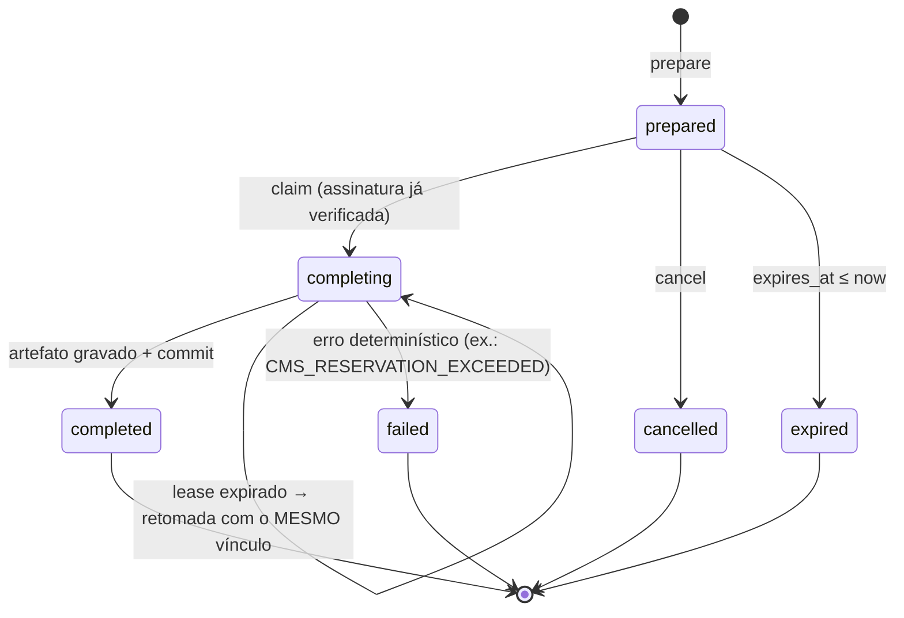

# Plano P1 — E3–E6: persistência, finalização, validação e assinaturas incrementais

Estado: **aprovado** em 27/11/2026 com as decisões da §15, que prevalecem sobre o texto anterior em caso de conflito. Pré-requisito cumprido: PR #2 mergeado (`6539868`). Dois PRs sequenciais: `feat/engine-persistence` (E3–E4, autorizado) e `feat/engine-validation` (E5–E6, ainda não autorizado). Sem certificado A1 real nesta etapa. Sem API HTTP (E9), sem política ICP-Brasil (E7).

Base: SPEC v2.3.1 (§§5, 7, 10, 11), ADR-0003/0014, plano P1 §§11–12, nota `docs/architecture/notes/P1-E2-pyhanko-spike.md`, contratos P0 (`PreparationStatus`, `Preparation`, `CompletePreparationRequest`, `ValidationReport`, `CertificateValidation`, taxonomia de erros).

Fatos verificados no código instalado (pyHanko 0.38.2, pyhanko-certvalidator 0.33.0, CPython 3.13.18):
- O SQLite embutido é 3.54.1 (WAL, tabelas `STRICT`, `RETURNING`, JSON) e faz parte da biblioteca padrão, sem dependência nova.
- `ValidationContext` aceita `trust_roots`, `revinfo_policy: CertRevTrustPolicy`, `moment`, `crls`, `ocsps`, `allow_fetching` e `fetcher_backend`. `REQUIRE_REVINFO` = `CRL_OR_OCSP_REQUIRED` para entidade final e para ACs intermediárias.
- Com `trust_roots=None`, o certvalidator usa a **lista de confiança do sistema operacional** (com `DeprecationWarning`); `extra_trust_roots` **soma** raízes à lista do sistema.
- `PdfSignatureStatus` expõe `coverage`, `diff_result`, `docmdp_ok`, `validation_time` e `revocation_details`. `ModificationLevel` tem os níveis `NONE`, `LTA_UPDATES`, `FORM_FILLING`, `ANNOTATIONS` e `OTHER`. `AdESIndeterminate` inclui `TRY_LATER`, `REVOKED_NO_POE`, `NO_CERTIFICATE_CHAIN_FOUND` e `OUT_OF_BOUNDS_NO_POE`.

## 1. Escolha de persistência

**Proposta: SQLite (stdlib `sqlite3`) para metadados e controle de estado + filesystem privado para PDFs.**

| Alternativa | Avaliação |
|---|---|
| SQLite em WAL | Transações ACID e compare-and-set com `BEGIN IMMEDIATE`. Seguro entre processos no mesmo host e recuperável após crash pelo journal. Zero serviço e zero dependência. **Escolhida.** |
| Somente arquivos JSON + locks | Sem transação entre metadado e estado; CAS e recuperação frágeis. Rejeitada. |
| PostgreSQL | Já está no stack do Hub, mas acoplaria o Engine a credenciais e schema de outro serviço, sem necessidade demonstrada. Fica como adaptador futuro atrás da mesma interface. |
| LMDB ou RocksDB | Exigiriam dependência nativa nova sem ganho para este volume. Rejeitadas. |

**Limitações concretas do SQLite, e por que são aceitáveis agora:**
1. Há um único escritor por vez; as gravações são curtas (CAS e commit), com `busy_timeout` e retry.
2. O WAL exige memória compartilhada no mesmo host, então **não** pode ficar em NFS/SMB. O Engine valida isso na inicialização: o diretório precisa ser local e o `journal_mode` tem de retornar `wal`.
3. Não suporta várias instâncias do Engine em hosts diferentes compartilhando estado.

Se algum dia houver necessidade comprovada (P8), entra um adaptador PostgreSQL implementando `PreparationRepository`, com ADR próprio. Não haverá Valkey nem serviço novo.

## 2. Layout em disco (`ENGINE_DATA_DIR`, privado, 0700, dono = usuário do Engine)

```text
ENGINE_DATA_DIR/
  engine.sqlite3 (+ -wal, -shm)       # metadados, envelopes cifrados, eventos
  prepared/<preparation_id>.bin       # PDF preparado CIFRADO (AES-256-GCM)
  artifacts/<preparation_id>/<sha256>.bin   # artefato final imutável CIFRADO (0440)
  tmp/                                # escrita atômica (mesmo filesystem)
```

- O original continua vindo de `storage_ref`, gravado pelo Hub no storage privado (P0).
- O PDF preparado é dado temporário do Engine e fica cifrado em repouso, porque contém o documento e o certificado do titular.
- O artefato final também fica cifrado enquanto armazenado no Engine (§15.2); a entrega ao Hub (E9) decifra em memória.
- Escrita atômica: arquivo temporário em `tmp/` → `fsync` → `os.link` para o nome final (falha se já existir) → `fsync` do diretório → remoção do temporário. Se o destino já existir com o **mesmo** SHA-256, a operação é idempotente; com SHA diferente, é erro de integridade. Nunca sobrescrever.

## 3. Modelo de dados (SQLite, tabelas `STRICT`)

```sql
CREATE TABLE schema_migrations (version INTEGER PRIMARY KEY, applied_at TEXT NOT NULL) STRICT;

CREATE TABLE preparations (
  preparation_id        TEXT PRIMARY KEY,            -- UUIDv7 canônico
  status                TEXT NOT NULL CHECK (status IN
                          ('prepared','completing','completed','cancelled','expired','failed')),
  state_version         INTEGER NOT NULL,            -- monotônico; +1 a cada transição
  document_version_id   TEXT NOT NULL,
  document_sha256       TEXT NOT NULL,               -- hex
  certificate_sha256    TEXT NOT NULL,               -- hex
  prepared_pdf_sha256   TEXT NOT NULL,               -- hex do PDF preparado em claro
  digest_algorithm      TEXT NOT NULL,
  signature_algorithm   TEXT NOT NULL,
  policy                TEXT NOT NULL,
  created_at            TEXT NOT NULL,
  expires_at            TEXT NOT NULL,
  updated_at            TEXT NOT NULL,
  state_envelope        BLOB,                        -- AEAD; NULL após o descarte lógico do estado sensível
  key_id                TEXT NOT NULL,
  lease_owner           TEXT,                        -- processo que finaliza
  lease_expires_at      TEXT,
  completion_attempt_id TEXT,
  completion_signature_sha256 TEXT,                  -- SHA-256 da assinatura RAW aceita
  artifact_ref          TEXT,
  artifact_sha256       TEXT,
  artifact_size         INTEGER,
  error_code            TEXT,
  row_mac               BLOB NOT NULL                -- HMAC dos campos mutáveis (§4.4)
) STRICT;
CREATE INDEX preparations_status_expires ON preparations(status, expires_at);

CREATE TABLE preparation_events (                    -- append-only, sem dados pessoais
  event_id INTEGER PRIMARY KEY, preparation_id TEXT NOT NULL REFERENCES preparations,
  from_status TEXT, to_status TEXT NOT NULL, state_version INTEGER NOT NULL,
  code TEXT, at TEXT NOT NULL, chain_mac BLOB NOT NULL
) STRICT;

CREATE TABLE key_usage (key_id TEXT PRIMARY KEY, encryptions INTEGER NOT NULL) STRICT;
```

**Conteúdo do envelope (texto claro, JSON com schema interno `preparation-state/v1`):** `signed_attrs_der`, `certificate_der`, `chain_der[]`, `byte_range_digest`, `reserved_region_start/end`, `field_name`, versão do pyHanko usada na preparação e versão do schema. Esse conteúdo é imutável após a preparação. Campos que só precisam ser consultados ficam em claro na tabela; campos com dado pessoal (certificado e cadeia) ou necessários à assinatura ficam no envelope.

## 4. Criptografia do estado

### 4.1 Chaves
- `ENGINE_STATE_KEY` (Base64url de 32 bytes aleatórios) + `ENGINE_STATE_KEY_ID`, **ou** `ENGINE_STATE_KEY_FILE`. O arquivo é um keyring JSON `{"active_key_id": "...", "keys": {"<id>": "<b64url>"}}` e precisa ter permissão ≤ 0600 e o mesmo dono do processo.
- As duas formas juntas → erro. Nenhuma → **o Engine não inicia**. Jamais gerar chave na inicialização.
- `key_id`: `^[A-Za-z0-9._-]{1,64}$`. A chave nunca é registrada em log nem aparece em mensagens de erro.

### 4.2 Envelope v1 (binário)
`"SPS1"` (magic, 4) ‖ `version`=1 (1) ‖ `len(key_id)` (1) ‖ `key_id` ‖ `nonce` (12, `os.urandom`) ‖ `ciphertext‖tag` (tag de 16).

- `AESGCM(key).encrypt(nonce, plaintext, aad)` da `cryptography`.
- **AAD** (bytes canônicos, separados por `0x00`): `"signport-engine/preparation-state"`, versão do envelope, `preparation_id`, `document_sha256`, `certificate_sha256`, `prepared_pdf_sha256`, `created_at`, `purpose` (`state` ou `prepared-pdf`).
- **Unicidade do nonce:** nonce aleatório de 96 bits por operação, mais um contador por `key_id` em `key_usage`, incrementado na mesma transação. Acima de 2^31 cifragens com uma chave (bem abaixo do limite NIST de 2^32 para nonce aleatório), o Engine recusa a operação e exige rotação.
- O PDF preparado usa o mesmo esquema, com `purpose=prepared-pdf` e nonce próprio.

### 4.3 Rotação
- A chave ativa cifra; as antigas presentes no keyring só decifram.
- Comando de manutenção `rewrap` (biblioteca, com CLI interna em E10): recifra os envelopes não terminais com a chave ativa, em transação, incrementando `state_version`.
- Uma chave só pode ser retirada quando nenhuma linha a referencia (`SELECT count(*) WHERE key_id=?`); preparações terminais têm o envelope descartado (descarte lógico do estado sensível).
- `key_id` desconhecido → falha fechada (`INTERNAL_ERROR`, log sem detalhes).

### 4.4 Adulteração, troca de contexto e rollback
| Ameaça | Defesa |
|---|---|
| Bytes do envelope ou do PDF preparado alterados | A tag GCM falha → falha fechada |
| Envelope de outra preparação copiado (troca de contexto) | A AAD inclui `preparation_id` e os hashes → falha |
| Campos mutáveis alterados no banco (status, vínculo de conclusão, artefato) | `row_mac` = HMAC-SHA256 com chave derivada por HKDF-SHA256 da chave de estado (`info="row-mac"`), sobre `preparation_id`, `status`, `state_version`, `completion_*` e `artifact_*` |
| Linha revertida para versão anterior | `state_version` monotônico + `preparation_events` com `chain_mac` encadeado. Uma linha revertida diverge do último evento → falha fechada |
| Banco inteiro restaurado de backup antigo | **Não detectável localmente.** Mitigação fora do Engine: autorização de uso único consumida no Hub (P1.5) e SHA do artefato registrado pelo Hub. Risco residual documentado |

## 5. Interfaces

```python
class Clock(Protocol):
    def now(self) -> datetime: ...

class StateCipher(Protocol):
    def seal(self, plaintext: bytes, aad: bytes) -> bytes: ...
    def open(self, envelope: bytes, aad: bytes) -> bytes: ...
    def row_mac(self, fields: bytes) -> bytes: ...

class BlobStore(Protocol):  # filesystem privado
    def put_immutable(self, relpath: str, data: bytes) -> str: ...   # retorna sha256
    def get(self, relpath: str) -> bytes: ...
    def delete(self, relpath: str) -> None: ...

class PreparationRepository(Protocol):
    def create(self, record: PreparationRecord) -> None: ...
    def get(self, preparation_id: str) -> PreparationRecord: ...
    def claim_completion(self, preparation_id: str, *, attempt_id: str, signature_sha256: str,
                         owner: str, lease_until: datetime, now: datetime) -> ClaimResult: ...
    def mark_completed(self, preparation_id: str, *, owner: str, artifact: ArtifactInfo,
                       now: datetime) -> PreparationRecord: ...
    def mark_failed(self, preparation_id: str, *, owner: str, code: str, now: datetime) -> None: ...
    def cancel(self, preparation_id: str, *, now: datetime) -> PreparationRecord: ...
    def expire_due(self, *, now: datetime, limit: int) -> list[str]: ...
    def terminal_for_cleanup(self, *, older_than: datetime, limit: int) -> list[str]: ...
```

- `PreparationService` orquestra preparar, finalizar, cancelar, expirar e limpar, usando a lógica pura de E2 (`external_signing`).
- `ClaimResult` é um de: `CLAIMED`, `ALREADY_COMPLETED(record)`, `IN_PROGRESS_SAME_BINDING`, `CONFLICT`, `EXPIRED` ou `NOT_CLAIMABLE`.
- Uma suíte de testes de contrato do repositório roda contra qualquer implementação. Na P1 a única implementação é a SQLite; não haverá implementação em memória que possa divergir.

## 6. Máquina de estados (E4)



Regras:
1. A finalização **verifica antes de mudar o estado**: carrega e decifra; valida todos os vínculos de §7; verifica a assinatura RAW. Uma assinatura inválida **não** consome a preparação: o estado continua `prepared`, o Engine devolve `SIGNATURE_INVALID` e registra um evento.
2. `claim` faz o CAS `prepared → completing` em `BEGIN IMMEDIATE`, gravando `completion_attempt_id`, `completion_signature_sha256` e o lease, e exige `now < expires_at`.
3. A idempotência usa `(attempt_id, sha256(assinatura))`. Com o mesmo par, `completed` devolve o artefato existente e `completing` retoma (lease expirado) ou responde "em andamento". Com outro par, `CONFLICT`.
4. Estados terminais não ressuscitam. `cancel` só vale a partir de `prepared`; em `completing`, retorna `CONFLICT`.
5. Ordem de gravação: o artefato vai para o filesystem (atômico, imutável) **antes** do commit `completed` com o SHA. Na recuperação, se o arquivo já existe com o SHA esperado, o Engine só completa o commit.
6. A montagem do CMS é determinística dado o mesmo estado e a mesma assinatura. A retomada reproduz os mesmos bytes, e um teste exige SHA idêntico.
7. Expiração e limpeza: `expire_due` move `prepared` vencidos para `expired`. A limpeza remove o PDF preparado e anula `state_envelope` (descarte lógico do estado sensível) dos terminais, e mantém os metadados por `ENGINE_TERMINAL_RETENTION` (padrão proposto: 7 dias) para garantir idempotência. Arquivos órfãos em `tmp/` e `artifacts/` sem linha correspondente são removidos após um período de carência.
8. O Engine **nunca** "publica": `completed` significa apenas "artefato assinado e verificado criptograficamente". A liberação depende do relatório de validação (E5) e da decisão do Hub; `indeterminate` ou `invalid` jamais liberam.

## 7. Verificações obrigatórias na finalização (requisitos do PR #2)

1. Recalcular o SHA-256 do certificado decifrado e compará-lo com `certificate_sha256` da linha **e** do pedido.
2. Comparar `signingCertificateV2` com o certificado: SHA-256 do DER e `issuerSerial` (issuer e serial).
3. Validar os algoritmos da preparação contra o pedido e contra a configuração (SHA-256 com RSA_PKCS1_V1_5).
4. Validar os offsets: `0 < start < end ≤ len(pdf)`; `end − start − 2` positivo e par; delimitadores `<` e `>` nas posições certas; região preenchida só com hex.
5. Analisar o `/ByteRange` efetivo do PDF preparado (parser estrito no `src`, independente do pyHanko, extraído do helper de teste de E2) e exigir `[0, start, end, len − end]`.
6. Recalcular o SHA-256 dos bytes cobertos e compará-lo com `byte_range_digest`.
7. Comparar o `messageDigest` dos atributos com o digest **recalculado**.
8. Depois de gravar, comparar byte a byte tudo fora da região reservada (prefixo e sufixo iguais ao preparado) e checar que o tamanho não mudou.
9. Calcular o SHA-256 do artefato final e persistir `artifact_sha256` e `artifact_size`.
10. Atomicidade, idempotência, concorrência e recuperação (§6).
11. Não publicar artefatos inválidos ou indeterminados (§6.8).

## 8. E5 — Validação

1. **Trust stores explícitos.** O `TrustStore` é carregado de diretório com manifesto versionado (SHA-256 por certificado, nome e versão do bundle).
   - Sempre há `trust_roots` não vazio; usar `extra_trust_roots` é proibido.
   - Teste: construir a validação sem trust store é impossível (erro de tipo e de execução), e o caminho de raízes do sistema dispara `DeprecationWarning`, que vira erro no pytest.
   - Os stores sintético e ICP-Brasil são separados por identificador, e o bundle ICP entra só em E7 (L08).
2. **Política de revogação explícita.** `CertRevTrustPolicy(RevocationCheckingPolicy(ee_certificate_rule=CRL_OR_OCSP_REQUIRED, intermediate_ca_cert_rule=CRL_OR_OCSP_REQUIRED))` passado por `revinfo_policy`. O parâmetro legado `revocation_mode` não é usado. Teste: um signatário sem CRL DP e revogado na CRL fornecida → `invalid`.
3. **Classificação da revogação** (P0 `Check.status` + `code`):

| Situação | status | code |
|---|---|---|
| Revogado | `failed` | `REVOKED` |
| Evidência indisponível (rede, timeout, URL bloqueada, nenhuma fonte) | `indeterminate` | `REVOCATION_UNAVAILABLE` |
| Evidência inválida (assinatura da CRL/OCSP inválida, emissor errado, desatualizada, fora da janela) | `indeterminate` | `REVOCATION_EVIDENCE_INVALID` |
| Não revogado, evidência válida | `passed` | — |

4. **Instante da validação.** Sem carimbo de tempo (fora da P1), `moment` = instante da validação, registrado em `checked_at`. O `/M` declarado pelo signatário nunca é usado como verdade.
5. **Busca de revogação com proteção contra SSRF.**
   - Desligada por padrão; o modo offline aceita CRL/OCSP fornecidos.
   - Quando ligada, o próprio SignPort coleta as URLs (CRL DP e AIA/OCSP) e busca com um cliente restrito:
     - só `http`/`https`, portas 80 e 443;
     - resolução DNS feita pelo Engine, conexão no IP já validado (contra DNS rebinding);
     - bloqueio de loopback, RFC 1918, link-local (169.254/16 e fe80::/10), ULA, multicast, reservados e IPv4 mapeado em IPv6;
     - sem redirecionamento;
     - limites de tamanho (configurável, padrão proposto de 10 MiB), de tempo por requisição e total, e de concorrência.
   - O certvalidator recebe o resultado com `allow_fetching=False`.
   - Dependência: `aiohttp` já é transitiva (pyHanko/certvalidator); proposta de promovê-la a dependência explícita fixada. Se a montagem de requisição OCSP pela API pública do certvalidator não for adequada, decidir no início da E5, com evidência.
6. **Resultado.** Mapeado para `ValidationReport` da P0: `integrity`, `coverage`, `chain`, `validity_period`, `revocation`, `key_usage`, `policy`, `timestamp` e `modifications`.
   - Decisão `indeterminate` sempre que faltar evidência. Sub-indicações AdES (`ades_basic_validation`) são preservadas internamente para o mapeamento.
   - Nesta etapa, `policy` = `not_applicable` ou `indeterminate` (E7). Validade criptográfica **não** é conformidade normativa.
7. **Limites de recursos.** Número máximo de assinaturas por PDF, profundidade da cadeia, tamanho de CRL e timeout total da validação (`asyncio.timeout`).

## 9. E6 — Assinaturas incrementais

1. **Assinar PDF já assinado.** Preparação incremental; o prefixo do arquivo original é preservado byte a byte, e todas as assinaturas anteriores continuam validando.
2. **DocMDP.** O Engine não certifica documentos na v1 (o contrato P0 não tem esse campo). Os testes criam PDFs certificados com pyHanko diretamente.
   - Certificado com P=1 → a preparação é rejeitada (`DOCUMENT_INVALID`, mensagem "DocMDP forbids changes").
   - P=2 e P=3 permitem nova assinatura conforme a especificação.
   - Confirmar no início da E6 se o pyHanko rejeita P=1 sozinho ou se o Engine precisa checar antes.
3. **FieldMDP.** Campos bloqueados por uma assinatura anterior não podem ser alterados; um teste altera o valor de um campo bloqueado e espera `modifications=failed`.
4. **Classificação de modificações** (P0 `modifications`):
   - `NONE` e `LTA_UPDATES` → `passed`;
   - `FORM_FILLING` e `ANNOTATIONS` → `passed` só se DocMDP/FieldMDP permitirem; senão, `failed`;
   - `OTHER` ou modificação suspeita → `failed`.
5. **Testes:** segunda assinatura por outro titular sintético; certificar e depois assinar; P=1 rejeitado; atualização incremental maliciosa depois da primeira assinatura (troca de conteúdo de página, objeto sobrescrito) detectada; assinatura numa revisão anterior coberta parcialmente; campo de assinatura removido.

## 10. Cenários de falha (todos com teste)

| # | Cenário | Comportamento esperado |
|---|---|---|
| F1 | Crash depois do claim, antes de gravar o artefato | Lease expira; retomada com o mesmo vínculo; mesmo SHA |
| F2 | Crash depois do rename do artefato, antes do commit | Recuperação encontra o arquivo com o SHA esperado e só faz o commit `completed` |
| F3 | Crash no meio da escrita em `tmp/` | Temporário órfão removido; o nome final nunca existe parcialmente |
| F4 | Disco cheio ou erro de I/O | Continua `completing` (transitório) e o retry funciona; nada é publicado |
| F5 | Dois processos finalizam com o mesmo par (attempt, assinatura) | Um único artefato; os dois recebem a mesma resposta |
| F6 | Dois processos com assinaturas diferentes | O primeiro conclui; o segundo recebe `CONFLICT` |
| F7 | Expiração durante a finalização | `claim` exige `now < expires_at`; depois do claim, completa dentro do lease |
| F8 | Engine sem chave configurada | Não inicia |
| F9 | Chave rotacionada com preparação em curso | A chave antiga decifra; `rewrap` posterior funciona |
| F10 | Envelope ou PDF preparado adulterado | Falha fechada (tag GCM) |
| F11 | Envelope trocado entre preparações | Falha fechada (AAD) |
| F12 | Linha alterada ou revertida no banco | `row_mac` ou cadeia de eventos falha → falha fechada |
| F13 | `SQLITE_BUSY` | Retry com `busy_timeout`; sem estado parcial |
| F14 | Processo morto com `kill -9` segurando o lease | Outro processo retoma depois do lease |
| F15 | Relógio regressivo | Lease e expiração usam o `Clock` injetado; testes com saltos |
| F16 | `ENGINE_DATA_DIR` em NFS ou WAL indisponível | Recusa iniciar |
| F17 | CMS maior que a reserva | `failed` + `CMS_RESERVATION_EXCEEDED`; exige nova preparação e nova autorização |

Mecanismo de teste: uma interface `FaultPoints`, injetada no serviço (no-op em produção), com pontos nomeados (`after_claim`, `after_artifact_rename`…). Os crashes reais são feitos com `multiprocessing` (spawn) e `os.kill(SIGKILL)` em subprocessos.

## 11. Dependências

- E3/E4: **nenhuma dependência nova de runtime** (`sqlite3`, `cryptography` AESGCM, HKDF e HMAC).
- E5: promover `aiohttp` (já transitiva, Apache-2.0/MIT) a dependência direta fixada, se aprovada.
- Dev: nenhuma nova prevista (pytest já cobre `multiprocessing`). `hypothesis` fica para E10.

## 12. Testes e critérios de aceite

**E3 — Persistência**
- [ ] Migrações versionadas; `journal_mode=wal`; `foreign_keys=ON`; tabelas `STRICT`.
- [ ] Envelope v1: ida e volta; adulteração, AAD trocada, chave errada, `key_id` desconhecido, versão desconhecida e magic inválido → falha fechada.
- [ ] Nonce: unicidade estatística em 10⁵ cifragens; limite de uso por chave respeitado.
- [ ] Chave: ausente → não inicia; ambas as formas → erro; arquivo com permissão > 0600 → erro; keyring com rotação.
- [ ] Preparar no processo A, finalizar no processo B (subprocess): PDF válido, verificado pelo OpenSSL.
- [ ] Expiração e limpeza (descarte lógico do estado sensível) testadas com relógio injetado.
- [ ] Nenhum dado pessoal em texto claro no banco (teste busca o DER do certificado e o nome sintético nos bytes do arquivo SQLite).

**E4 — Finalização**
- [ ] Todos os itens de §7, cada um com teste negativo dedicado.
- [ ] Assinatura inválida não consome a preparação.
- [ ] Idempotência: repetição idêntica devolve o mesmo artefato e o mesmo SHA; divergente → `CONFLICT`.
- [ ] Concorrência entre processos (F5, F6) com barreira; um único artefato no disco.
- [ ] F1–F4, F13 e F14 reproduzidos.
- [ ] Artefato 0440, nunca sobrescrito; SHA persistido igual ao do arquivo.
- [ ] Os estados retornados validam contra `Preparation` e `CompletePreparationResponse` da P0.

**E5 — Validação**
- [ ] O teste de regressão de E2 continua passando, e o caminho de produção rejeita o caso.
- [ ] Revogado → `failed/REVOKED`; indisponível → `indeterminate/REVOCATION_UNAVAILABLE`; inválida (CRL assinada por outra AC ou vencida) → `indeterminate/REVOCATION_EVIDENCE_INVALID`.
- [ ] Sem trust store explícito → impossível; DeprecationWarning de raízes do sistema nunca ocorre.
- [ ] Certificado expirado ou ainda não válido, KU errada, cadeia incompleta → dimensão correta.
- [ ] SSRF: loopback, 169.254.169.254, RFC 1918, IPv6 ULA/mapeado, redirecionamento, porta não permitida, resposta acima do limite e timeout são bloqueados (testes com servidor local controlado e resolvedor injetado).
- [ ] O relatório valida contra `ValidationReport` e `CertificateValidation` da P0.

**E6 — Incrementais**
- [ ] Duas assinaturas válidas; revisão anterior preservada byte a byte.
- [ ] DocMDP P=1 rejeitado; P=2 permite assinatura.
- [ ] FieldMDP violado → `modifications=failed`.
- [ ] Atualização maliciosa após assinatura classificada como `failed`.

Comandos de aceite (CI e local): `uv sync --locked`, Ruff, Pyright strict, `SIGNPORT_REQUIRE_OPENSSL=1 uv run --locked pytest -ra`, suíte da P0.

## 13. Sequência sugerida de commits (`feat/engine-persistence`)

1. `build(engine): pin Python patch and managed interpreter` (plano P1 §12.2).
2. `feat(engine): add encrypted versioned preparation state`
3. `feat(engine): add SQLite preparation repository and private blob store`
4. `feat(engine): implement finalization state machine with full binding checks`
5. `feat(engine): add explicit trust stores and strict revocation policy`
6. `feat(engine): add guarded revocation fetching` (se aprovado)
7. `feat(engine): support incremental signatures, DocMDP and FieldMDP`
8. `docs(engine): record E3–E6 evidence`

Esta é a sugestão de um PR único E3–E6, conforme a estratégia aprovada. Se preferir revisões menores, o PR pode ser dividido em E3–E4 e E5–E6.

## 14. Decisões que pedem aprovação

1. SQLite (stdlib) em WAL + filesystem privado, com as limitações de §1 (um host, sem NFS) e PostgreSQL apenas como adaptador futuro com ADR.
2. Cifrar também o PDF preparado (temporário), não só o envelope de estado.
3. Proteção de rollback por `row_mac` + cadeia de eventos, aceitando como risco residual a restauração do banco inteiro (mitigada pelo Hub).
4. Assinatura inválida não consome a preparação; só a válida faz o claim.
5. Retenção padrão: preparação 10 min (SPEC §10); metadados terminais 7 dias; descarte lógico dos envelopes terminais.
6. Busca online de revogação desligada por padrão, com cliente próprio restrito contra SSRF; `aiohttp` promovido a dependência direta.
7. Engine não certifica (DocMDP) na v1; PDFs certificados só como entrada.
8. Python patch fixado (`3.13.18`) com `only-managed` no CI (plano P1 §12.2).

## 15. Decisões da revisão de 27/11/2026 (prevalecem)

### 15.1 Escopo e Git
- `feat/engine-persistence`: somente E3–E4. `feat/engine-validation`: E5–E6, a partir da `main` atualizada após o merge da anterior.
- As atualizações de planos entram como primeiro commit documental da branch; não haverá PR só de documentação.
- Os commits de implementação, o push e o PR aguardam nova revisão. Sem co-autoria. Sem A1 real.

### 15.2 Persistência e cifragem
- SQLite (stdlib) com `journal_mode=WAL`, `synchronous=FULL`, `foreign_keys=ON` e `busy_timeout` configurável (padrão 5000 ms). `PreparationRepository` independente do SQLite; PostgreSQL só com ADR e necessidade demonstrada.
- Limitações documentadas: host único, armazenamento local (sem NFS/SMB), um escritor por vez.
- AES-256-GCM (`cryptography`) para estado, PDF preparado e PDF final armazenado no Engine. Nenhum PDF temporário em claro no disco.
- Subchaves HKDF-SHA256 por finalidade: `state`, `artifact` e `metadata-mac`, derivadas de cada chave mestra do keyring.
- AAD vinculada à instalação (`ENGINE_INSTANCE_ID`, gravada no banco na primeira inicialização; divergência → recusa iniciar), à preparação e à finalidade.
- Nonce de 96 bits = 32 bits aleatórios ‖ contador de 64 bits reservado de forma durável no banco (transação `BEGIN IMMEDIATE`), por `(key_id, finalidade)`, antes de cada uso. Isso é seguro sob concorrência e falha: um contador reservado e não usado nunca é reaproveitado. Há um limite de uso por chave.
- Keyring com rotação: a chave ativa cifra e as anteriores decifram (estado e artefatos existentes). Nenhuma chave é gravada junto aos dados: o arquivo de chave não pode ficar dentro de `ENGINE_DATA_DIR`. Sem configuração válida, o Engine não inicia.

### 15.3 Rollback e recuperação
- `row_mac` + cadeia de eventos aprovados, com as limitações documentadas: protegem contra alteração e reversão parcial, **não** contra restauração integral do armazenamento (risco residual aceito nesta etapa; nenhuma proteção absoluta contra rollback é declarada).
- Restaurar backup pode fazer o contador de nonces retroceder. Procedimento obrigatório: recuperação controlada com **rotação para uma chave nunca usada** antes de qualquer nova cifragem, e invalidação das preparações não terminais anteriores à restauração. Elas serão reconciliadas com o Hub quando a P1.5 existir. O consumo de uso único da P1.5 é uma camada adicional e não substitui esta.

### 15.4 Finalização
Os onze critérios do plano P1 §12.1 são implementados. Além deles:
- Idempotência vinculada à preparação, tentativa, contexto (certificado e algoritmos) e hash da assinatura.
- Repetições válidas devolvem o artefato existente; finalizações concorrentes divergentes são excluídas.
- Recuperação entre filesystem e SQLite; publicação atômica do resultado; expiração, cancelamento e limpeza segura.
- Nenhuma assinatura é classificada como normativamente válida antes de E5/E7.

### 15.5 Decisões antecipadas para E5–E6 (não implementar agora)
Trust stores explícitos; política estrita de revogação; busca online desligada por padrão; `aiohttp` como dependência direta quando utilizado; cliente com proteção contra SSRF e DNS rebinding, bloqueio de endereços não públicos, limites e timeouts; nenhum fetcher alternativo que contorne esses controles; DocMDP e FieldMDP; preservação de assinaturas incrementais; Engine sem certificação de documentos na API v1.

### 15.6 Ambiente
`.python-version` = `3.13.18`; `UV_PYTHON_PREFERENCE=only-managed` no CI; teste explícito de ambiente.

### 15.7 Revisão de código E3–E4 (REV-01 a REV-14)
O registro completo está em `docs/architecture/notes/P1-E3-E4-code-review.md`. A terminologia *crypto-shred* foi substituída por **descarte lógico do estado sensível** (REV-11): a limpeza remove referências e arquivos cifrados, mas não destrói uma chave exclusiva por preparação, de modo que cópias em WAL, backups ou remanência do armazenamento continuam protegidas apenas pela chave de estado.

### 15.8 Decisões da aprovação da revisão (27/11/2026)
- Envelope v2 aprovado como formato interno de referência; sem migração de estados experimentais v1; versões incompatíveis continuam rejeitadas explicitamente.
- Reserva durável de nonces em blocos aprovada.
- `MaintenanceLock` local e consultivo aprovado para implantação em host único.
- Risco residual de rollback coordenado de dados autenticados aceito.
- A avaliação de mecanismos externos de reconciliação e ancoragem no Hub fica registrada na P1.5 (ROADMAP).
- Sem novas dependências.
